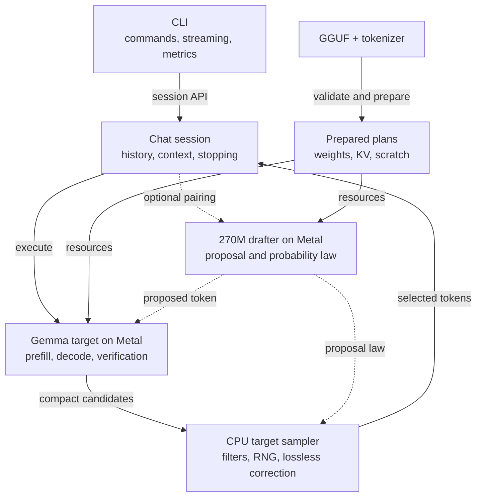
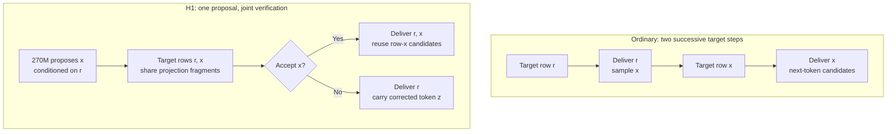

# Guffin

**Native Gemma inference for a fanless Mac.**

Guffin is a C++20 and Metal GGUF engine for local chat on a **16 GiB MacBook Air
M4**. It owns the path from model loading and tokenization to GPU kernels,
conversation caches and sampling. **Gemma 3 12B** is the main target, with a
native **Gemma 3 270M** speculative drafter. **Gemma 2 9B** remains supported.

The project investigates what makes complete chat faster on a constrained
machine. Its experiments focus on weight traffic, cache memory and proposal
verification. The resulting design reuses useful target work and keeps ownership
explicit; the [retrospective](docs/SPECULATIVE_DECODING_RETROSPECTIVE.md)
records which ideas survived, which failed and what those results actually establish.

[Run](#quick-start) · [Architecture](#inside-the-engine) · [Speculation](#how-h1-reuses-target-work) ·
[Lessons](#what-the-experiments-taught-us) · [Benchmarks](#performance) · [Code map](docs/GRAPH.md)

## Quick start

The tested setup is M4 / 16 GiB, macOS 26.6.2 and Apple clang 21. Install the
Xcode Command Line Tools if needed with `xcode-select --install`, then:

```sh
git clone https://github.com/Coach6/guffin.git
cd guffin
make -j4 install
```

Download the [tested Gemma 3 12B Q4_K_M GGUF][target-model] into `models/`.
Chat is the default:

```sh
guffin -m models/gemma-3-12b-it-Q4_K_M.gguf
```

For native lossless speculation, also put the [supported 270M Q8_0 drafter][draft-model]
in `models/`:

```sh
guffin -m models/gemma-3-12b-it-Q4_K_M.gguf \
  --draft-model models/gemma-3-270m-it-Q8_0.gguf
```

The installed command works from any directory; model paths may be relative
or absolute. Installation selects `/opt/homebrew/bin` when present, otherwise
`/usr/local/bin`. For a custom location, use `make install PREFIX="$HOME/.local"`
and add `$HOME/.local/bin` to `PATH`. Metal source is embedded in the executable;
installed inference needs no checkout assets, Python environment or network.

## Inside the engine

The CLI handles interaction. The session owns conversation behavior and
prepared plans; those plans own weights, key/value (KV) caches and scratch
buffers. Both target and drafter execute natively on Metal; final target sampling
runs on the CPU.



The optimization strategy removes repeated work at concrete boundaries:

| Decision | What it changes |
| --- | --- |
| [Pack quantized weights for GPU access](include/local_gguf_engine/tensor/kquant_packing.hpp) | Prepare adjacent output columns for parallel GPU lanes. Packed Q4/Q6 two-row projections reuse weight fragments without expanding the whole model to floating point. |
| [Calculate Q4 correction sums at their producers](src/engine/gemma_target_runtime.cpp) | Normalization, GELU and attention produce reusable activation sums; projections consume them without a separate launch. |
| [Use prompt-sized matrix tiles](src/tensor/backends/metal/metal_command_context.mm) | Larger Gemma 3 tiles reuse decoded weights across useful prompt rows; small decode batches retain compact kernels. |
| [Store target KV in F16](src/tensor/backends/metal/metal_kernels.mm) | Cached keys and values use half precision; attention accumulates in F32. Local-attention layers use bounded rings. |
| [Select candidates before GPU readback](src/engine/sampling.cpp) | Transfer compact candidates for configured CPU sampling, avoiding routine full-vocabulary readback. |

Fused Q4 sums serve Gemma 3 ordinary/H1 execution and Gemma 2 shared
verification. Gemma 3 preserves native Q4/Q6 weights and shares its tied
embedding/output-head allocation. Gemma 2's established policy requantizes Q6
down weights to Q4 and its F16 output head to Q8; those conversions change weights.

[llama.cpp](https://github.com/ggml-org/llama.cpp) is the broader external
reference. Guffin specializes selected Gemma paths for M4. Its contribution is
the native layout, scheduling and state integration of established methods;
current matched performance comparisons are pending.

## How H1 reuses target work

Speculation helps when its complete cycle costs less per delivered token than
ordinary decoding. **H1 drafts one token at a time.** It pairs the current
target-selected token `r` with a proposed continuation `x`.
Packed body projections can reuse fragments across those two causal rows.

The diagram starts with `r` selected but awaiting its target forward pass:



On acceptance, row `x` already provides candidates for the next target-selected
token. On rejection, its speculative suffix is discarded and the corrected draw
becomes the next token. Selecting that token needs no extra target forward;
processing and caching it happen in the next cycle.

**Lossless** means preserving the configured target sampling distribution.
Here `p` and `q` are the target and actual draft distributions. Acceptance uses
`min(1, p(x) / q(x))`; rejection samples the normalized positive part of `p − q`.
Identical seeded text is unnecessary. The algorithm follows [speculative sampling research][speculation-paper];
its engine implementation must also preserve filters, history and stopping.

## Correctness and ownership

Selected private verification rows are copied into the target cache before
callbacks; finalization retains the delivered prefix and restores any
uncommitted suffix. Target and draft caches, sampler state and callback
receipts must agree.

The contracts have direct evidence routes:

| Contract | Where to inspect it |
| --- | --- |
| Lossless probability correction and configured sampling filters | [Analytic sampling tests](tests/engine/lossless_sampling_tests.cpp) |
| Packed projections, fused sums and independent F16 rounding | [Metal numerical tests](tests/tensor/gemma3_metal_tests.cpp) |
| Target equations, local-cache wrap and callback/stop receipts | [Gemma 3 runtime tests](tests/engine/gemma3_target_runtime_tests.cpp) |
| Tickets retain stable storage through moves, completion and rollback | [Target/verifier ownership tests](tests/engine/gemma2_metal_plan_tests.cpp) |
| Descriptors are validated before allocation; views check backing storage | [Tensor admission tests](tests/tensor/tensor_tests.cpp) |

Independent references, fault injection and benchmark drivers are excluded from
shipping objects. Short authenticated checkpoint references pass; an independent
128-token natural-prompt comparison exceeds existing numerical bounds for an
unresolved reason. The [validation boundary](docs/SPECULATIVE_DECODING_RETROSPECTIVE.md#numerical-validation-has-a-boundary)
records its scope.

## What the experiments taught us

- **Optimize the whole speculative cycle.** Proposal quality and verifier cost
  must pay for drafting and state publication together. Larger horizons did
  not earn a retained chat advantage in the tested configurations.
- **Measure the complete conversation.** Fewer dispatches and faster isolated
  kernels sometimes failed to improve chat. Retained mechanisms must survive
  prompt processing, follow-ups, memory pressure and thermals.
- **Keep the numerical target explicit.** F16 KV and Gemma 2 requantization are
  precision choices. Lossless speculation preserves the selected target law.

Rejected runtime experiments are removed; their designs, measurements
and limits remain documented in the [engineering retrospective](docs/SPECULATIVE_DECODING_RETROSPECTIVE.md).

## Performance

**Release benchmarks and matched llama.cpp comparisons are pending.** Cells
remain blank until the planned testing pass; `—` means pending.

| Guffin mode | Prompt tok/s | Generation tok/s | Internal TTFT (ms) | First text (ms) | Peak footprint (GiB) |
| --- | ---: | ---: | ---: | ---: | ---: |
| Gemma 2 ordinary | — | — | — | — | — |
| Gemma 2 suffix retrieval | — | — | — | — | — |
| Gemma 3 ordinary | — | — | — | — | — |
| Gemma 3 + 270M H1 | — | — | — | — | — |

The testing pass will report pinned revisions, exact models and executed
precision, context and sampler settings, timing boundaries and system state.
[Performance evidence](docs/PERFORMANCE.md) keeps the measurement scope and
historical development results separate from these pending release figures.

## Everyday use and support

Interactive replies show prompt tokens/s, generation tokens/s and internal
TTFT. Internal TTFT ends at the first selected token; first visible text is a
separate boundary. Loading and startup warmup are separate from reply timings.

```sh
# One answer; requested timings go to stderr
guffin -m models/gemma-3-12b-it-Q4_K_M.gguf -p "Explain unified memory." -n 128 --stats

# Gemma 2 chat, with default suffix retrieval
guffin -m models/gemma-2-9b-Q4.gguf

# Disable all speculation for ordinary Gemma 2 decoding
guffin -m models/gemma-2-9b-Q4.gguf --no-speculative

# Inspect metadata and tensors without inference
guffin inspect models/gemma-3-12b-it-Q4_K_M.gguf
```

`/help` lists chat commands; Ctrl+C stops a reply and Ctrl+D exits at the prompt.
Piped stdout contains answers. `guffin --help` lists common options;
`--help-all` includes diagnostics, and `--version` reports the build identity.

- **Models:** tested Gemma 3 12B IT Q4_K_M, Gemma 2 9B IT Q4_K_M and the
  authenticated 270M Q8_0 drafter. Matching family names or filenames alone
  do not establish compatibility.
- **Context:** Gemma 3 defaults to 16K; `-c, --context-size` sets capacity within
  model/device limits. The drafter caps paired execution at 32K. The tested
  Gemma 2 model declares 8K. `--context-shift` drops oldest complete turns when full.
- **Scope:** text-only, Metal-first inference. Release builds target M4;
  other devices and OS versions are unvalidated. Gemma 4 is future work.

## Development

```sh
make                      # optimized executable
make MODE=debug test      # native correctness checks
bash scripts/ci.sh        # native and Python repository checks
make release-test         # optimized correctness checks
make uninstall            # use the installation PREFIX, if customized
```

Use [the code map](docs/GRAPH.md) to find the owning module and relevant tests.
Changes should preserve its numerical, ownership and lifecycle contracts;
performance claims need actual chat evidence. Optional checkpoint checks require
their authenticated artifacts. [Engine principles](docs/ENGINE_PRINCIPLES.md)
explain the design expectations.

For help or bug reports, [open an issue](https://github.com/Coach6/guffin/issues)
with your device, macOS version, `guffin --version`, model and command.
Project licensing is pending selection; model downloads have their own terms.
[Current state](docs/NEXT_TASK.md) records the development handoff.

[target-model]: https://huggingface.co/ggml-org/gemma-3-12b-it-GGUF/blob/e5feec63a04a7a5f9b4128bf469781359d1a3b1a/gemma-3-12b-it-Q4_K_M.gguf
[draft-model]: https://huggingface.co/ggml-org/gemma-3-270m-it-GGUF/blob/e7647be17ae1108f2f605ed061ca0608b171afff/gemma-3-270m-it-Q8_0.gguf
[speculation-paper]: https://proceedings.mlr.press/v202/leviathan23a.html
