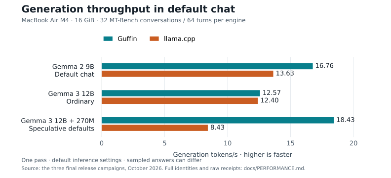
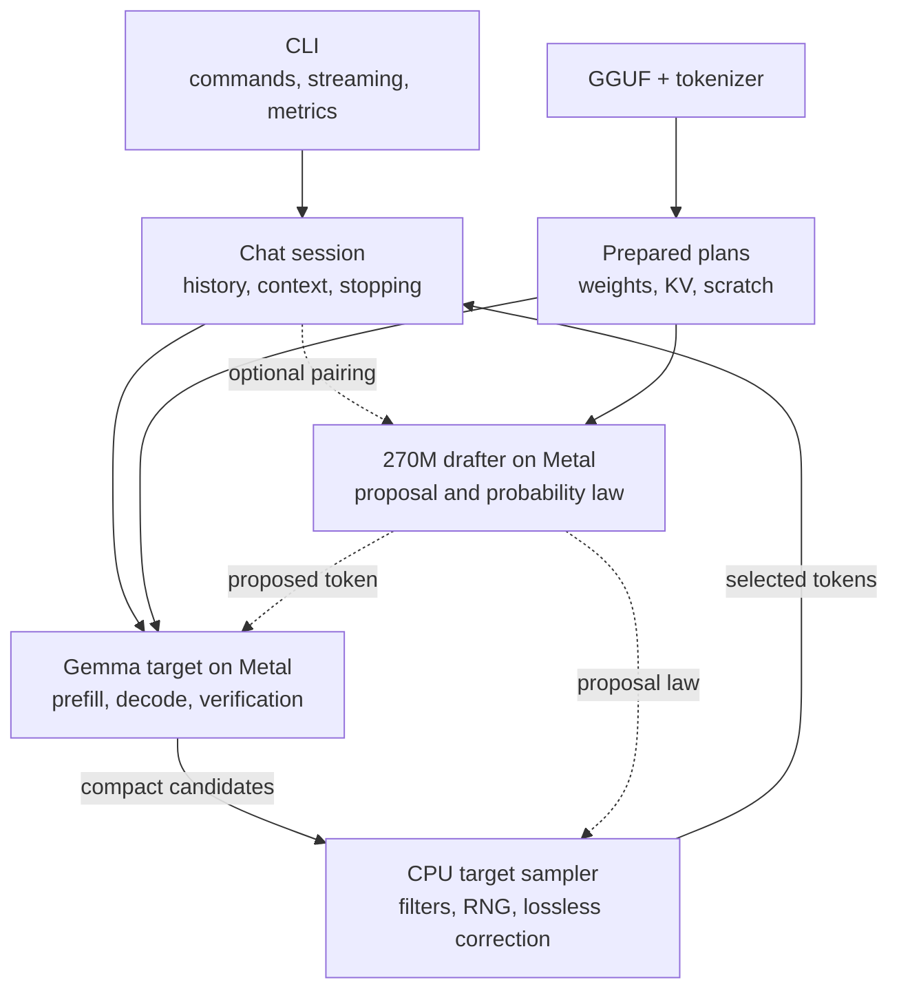
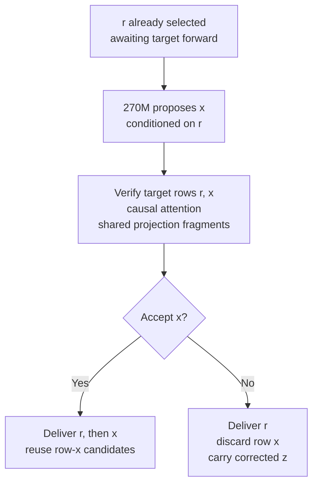

# Guffin

**Native Gemma inference for a fanless Mac.**

Guffin is a from-scratch C++20 and Metal GGUF engine for local chat on a
**16 GiB MacBook Air M4**. It owns loading, tokenization, GPU kernels,
conversation caches and sampling. **Gemma 3 12B** is the main target, with a
native **Gemma 3 270M** drafter; **Gemma 2 9B** is also supported. Inference
needs no other runtime or network.

The engineering question: **how much useful chat can we get from one pass
through the weights?** On the balanced chat benchmark, H1 recorded **47% higher
Gemma 3 generation throughput** than Guffin's ordinary campaign. Default Gemma 2
generation was **23% faster than llama.cpp**. The
[retrospective](docs/SPECULATIVE_DECODING_RETROSPECTIVE.md) explains the experiments.

[Run](#quick-start) · [Results](#measured-chat-performance) · [Architecture](#inside-the-engine) ·
[H1](#how-h1-reuses-target-work) · [Lessons](#what-the-experiments-taught-us) · [Code map](docs/GRAPH.md)

## Quick start

The tested setup is M4 / 16 GiB, macOS 26.6.2 and Apple clang 21. Install
Xcode Command Line Tools if needed with `xcode-select --install`, then:

```sh
git clone https://github.com/joelsjo01/guffin.git
cd guffin
make -j4 install
```

Download the [tested Gemma 3 12B Q4_K_M GGUF][target-model] into `models/`.
Chat is the default:

```sh
guffin -m models/gemma-3-12b-it-Q4_K_M.gguf
```

For lossless speculation, also download the [supported 270M Q8_0 drafter][draft-model]:

```sh
guffin -m models/gemma-3-12b-it-Q4_K_M.gguf \
  --draft-model models/gemma-3-270m-it-Q8_0.gguf
```

Installation uses `/opt/homebrew/bin` when present, otherwise `/usr/local/bin`.
For a custom location, use `make install PREFIX="$HOME/.local"` and add
`$HOME/.local/bin` to `PATH`. Run from any directory with relative or absolute
model paths. The executable embeds Metal source; inference needs no checkout
or Python environment. Keep model files unchanged while loaded.

## Measured chat performance

**MacBook Air M4 · 16 GiB · macOS 26.6.2 · llama.cpp 0.5.0 / build 11146.**

<details>
<summary>Exact test machine</summary>

| Component | Configuration |
| --- | --- |
| Mac | MacBook Air, 13-inch, M4, 2025 (`Mac16,12`), fanless |
| CPU | Apple M4, 10 cores: 4 performance + 6 efficiency |
| GPU | Apple M4, 10 cores, Metal |
| Unified memory | 16 GiB |
| Memory bandwidth | 120 GB/s, [Apple specification](https://support.apple.com/en-us/122209) |
| Storage | Apple AP0512Z NVMe SSD; 500.28 GB reported capacity |
| Software | macOS 26.6.2; Apple clang 21.0.0 |

CPU/GPU counts, memory, storage and software were queried on the test machine.
Memory bandwidth is the manufacturer's specification, not a measured result.

</details>

The balanced core contains **32 MT-Bench conversations / 64 turns per engine**,
spanning eight categories. Both engines use
the same user messages and GGUF downloads, with their own inference defaults.



| Core generation | Guffin | llama.cpp | Guffin / llama.cpp |
| --- | ---: | ---: | ---: |
| Gemma 2 9B default chat | **16.76 t/s** | 13.63 t/s | **1.23×** |
| Gemma 3 12B ordinary | **12.57 t/s** | 12.40 t/s | 1.01× |
| Gemma 3 12B + 270M speculative | **18.43 t/s** | 8.43 t/s | **2.19×** |

Gemma 3 ordinary throughput is essentially level here. H1 recorded
**47% higher generation throughput than Guffin's ordinary campaign** and **49%
higher than llama.cpp ordinary**. The **2.19×** ratio compares speculative
defaults: one-token H1 versus llama.cpp `draft-simple`, maximum three tokens,
which was slower than ordinary here. Other settings can change results.

Gemma 2's result includes Guffin's default suffix retrieval and Q6-down → Q4 /
F16-head → Q8 conversions. These conversions change the executed weights; the
result measures that complete default path.

### Responsiveness and memory

Internal time to first token (TTFT) ends at the first selected token; it
excludes model loading, tokenization and terminal transport. First replies and
follow-ups show conversation-cache reuse. Each cell is **Guffin / llama.cpp**
on the core suite.

| Core measurements | First-reply median TTFT | Follow-up median TTFT | Peak physical footprint |
| --- | ---: | ---: | ---: |
| Gemma 2 default | **0.409 / 0.654 s** | **0.255 / 2.529 s** | 9.15 / 2.58 GiB |
| Gemma 3 ordinary | **0.612 / 0.803 s** | **0.453 / 1.308 s** | 8.62 / 5.06 GiB |
| Gemma 3 speculative | **0.613 / 0.808 s** | **0.455 / 1.303 s** | 9.15 / 4.47 GiB |

H1 recorded essentially unchanged Guffin TTFT and a **0.53 GiB higher observed
peak footprint** than the ordinary campaign. Across all 38 conversations,
Guffin has lower internal TTFT on **all 42 follow-ups** in each campaign; large
first code/document prompts are slower than llama.cpp. Guffin's physical
footprint is higher. macOS accounts for copied and mapped weights differently;
reports include separate resident-memory measurements.

### Reading and reproducing the results

Each campaign includes **38 conversations / 80 turns per engine**. Six
supplementary conversations cover short chat, multilingual input,
code/document review and sustained discussion. Their separate throughput
ratios are **1.22× / 1.01× / 2.13×**, respectively.

The harness runs installed chat CLIs in a fresh process per conversation, with
five-minute cooldowns and two-minute message pauses. It adds diagnostic logging
to inference defaults. Generation rate is
`sum(max(selected tokens − 1, 0)) / sum(first-to-last selection time)`; rejected draft
tokens are excluded. Each case runs once; answers and follow-up histories can
differ. These are performance measurements, with no answer-quality evaluation.

The [benchmark guide](docs/BENCHMARKING.md) explains collection and timing;
[performance evidence](docs/PERFORMANCE.md) records hashes, settings, numerical
policies and limits. Each campaign preserves its manifest, answers, raw logs,
CSV/JSON and charts:

[Gemma 2 default](benchmarks/results/gemma2-release-v2/report/summary.md) ·
[Gemma 3 ordinary](benchmarks/results/gemma3-normal-release-v2/report/summary.md) ·
[Gemma 3 speculative](benchmarks/results/gemma3-speculative-release/report/summary.md)

## Inside the engine

The CLI handles interaction; the session owns conversation behavior and
prepared plans. Plans own weights, key/value (KV) caches and scratch. Target
and drafter run natively on Metal; final sampling runs on the CPU.



On this machine, reading the large model's weights is a major generation cost.
The design reduces repeated work and traffic:

| Mechanism | Useful work it saves |
| --- | --- |
| [Packed Q4/Q6 projections](include/local_gguf_engine/tensor/kquant_packing.hpp) | Adjacent output columns match GPU access. H1's two rows reuse weight fragments while body weights remain quantized. |
| [Q4 sums at their producers](src/engine/gemma_target_runtime.cpp) | Normalization, GELU and attention produce correction sums for compact one/two-row projections, avoiding a separate sum pass. |
| [Bulk prompt kernels](src/tensor/backends/metal/metal_command_context.mm) | Gemma 3 F32 matrix tiles reuse weights across prompt rows. Both families use fused F16-KV attention to avoid separate passes and intermediate buffers in device memory. |
| [Persistent weights, KV and scratch](src/engine/gemma2_metal_plan.cpp) | Setup owns storage; token loops reuse it. F16 KV and bounded local-attention rings reduce cache allocation; Gemma 3 shares its tied embedding/output head. |
| [Compact GPU readback](src/tensor/backends/metal/metal_command_context.mm) | Candidate selection avoids routine full-vocabulary transfer; the [CPU sampler](src/engine/sampling.cpp) remains authoritative. |

Gemma 2 converts and repacks into final Metal allocations and maps supported
immutable native matrices. Gemma 3 retains copied native weights, staged
projections, source-contiguous packing and bounded read-ahead. Authenticated
plans retain private payload copies; lifetime and snapshot isolation are explicit.

Guffin specializes Gemma paths for M4; [llama.cpp](https://github.com/ggml-org/llama.cpp)
serves a broader range of models and hardware. The contribution is native
layout, scheduling and state integration of established methods, with evidence
about which combinations help complete chat.

## How H1 reuses target work

**H1 proposes one token and verifies two causal target rows together.**
With `r` selected but awaiting its target forward, the 270M drafter proposes
continuation `x`. The target evaluates `[r, x]` together: row `r` provides the
distribution for accepting `x`; row `x` provides next-token candidates if
accepted. Packed body projections share weight fragments across both rows.



On rejection, the corrected draw becomes the next pending token. Selecting it
needs no extra target forward. Delivery publishes its cache prefix before the
token callback; visible text can appear later. Stops, token limits and callbacks
can end the illustrated cycle earlier.

**Lossless preserves the configured target sampling distribution.** For target
law `p` and actual draft law `q`, accept with `min(1, p(x) / q(x))`; on rejection,
sample the normalized positive part of `p − q`. Identical seeded text is
unnecessary. The [algorithm][speculation-paper] is implemented with sampling
filters, history and stopping preserved.

## Correctness and lessons

Selected private verification rows enter the target cache before callbacks.
Finalization keeps the delivered prefix and restores uncommitted suffixes.
Target/draft caches, sampler state and callback receipts must agree.

[Sampling tests](tests/engine/lossless_sampling_tests.cpp),
[Metal numerical tests](tests/tensor/gemma3_metal_tests.cpp),
[target lifecycle tests](tests/engine/gemma3_target_runtime_tests.cpp) and
[ownership tests](tests/engine/gemma2_metal_plan_tests.cpp) exercise those
contracts. Independent references, fault injection and benchmark drivers stay
outside shipping objects.

The Gemma 3 target keeps native Q4/Q6 weights, F16 KV, F32 attention and F32 prompt
projections. Short authenticated checkpoint references pass. The reproduced
128-token comparison passes the original full-model bounds with F32 KV and
exceeds them with F16 KV. The
[numerical investigation](docs/PERFORMANCE.md#numerical-limits) records this
unresolved rounding-feedback boundary. Lossless H1 preserves the native target's
sampling law, including its precision.

### What the experiments taught us

- **Optimize time per useful token.** Drafting, verification and publication
  must repay their combined cost. Larger horizons showed no retained chat
  advantage in the tested configurations.
- **Measure complete conversations.** Isolated kernel gains sometimes slowed
  chat. Prompt processing, follow-ups, memory and thermals decide whether
  changes help.
- **Scope negative results.** Complete designs, component probes and untrained
  drafters establish different things. Rejected machinery is removed;
  findings remain in the [retrospective](docs/SPECULATIVE_DECODING_RETROSPECTIVE.md).

## Everyday use and support

Interactive replies show prompt tokens/s, generation tokens/s and internal
TTFT. One-shot timings are optional; loading and warmup are separate.

```sh
# One answer; requested timings go to stderr
guffin -m models/gemma-3-12b-it-Q4_K_M.gguf -p "Explain unified memory." -n 128 --stats

# Gemma 2 chat, with default suffix retrieval
guffin -m models/gemma-2-9b-Q4.gguf

# Ordinary Gemma 2 decoding, with all speculation disabled
guffin -m models/gemma-2-9b-Q4.gguf --no-speculative

# Inspect metadata and tensors without inference
guffin inspect models/gemma-3-12b-it-Q4_K_M.gguf
```

`/help` lists chat commands; Ctrl+C stops a reply and Ctrl+D exits at the prompt.
Piped stdout contains answers. `guffin --help` lists common options;
`--help-all` includes diagnostics, and `--version` reports the build identity.

- **Models:** tested Gemma 3 12B IT Q4_K_M, Gemma 2 9B IT Q4_K_M and the
  authenticated 270M Q8_0 drafter. Matching names alone do not establish support.
- **Context:** Gemma 3 defaults to 16K; `-c, --context-size` sets capacity within
  model/device limits. The drafter caps paired execution at 32K. The tested
  Gemma 2 model declares 8K. `--context-shift` drops oldest complete turns when full.
- **Scope:** text-only, Metal-first inference. Release builds target M4;
  other devices and OS versions are unvalidated. Gemma 4 is future work.

## Development

```sh
make                      # optimized executable
make MODE=debug test      # native correctness checks
bash scripts/ci.sh        # native and Python repository checks
make release-test         # optimized correctness checks
make uninstall            # use the installation PREFIX, if customized
```

The [code map](docs/GRAPH.md) links owning modules and tests;
[engine principles](docs/ENGINE_PRINCIPLES.md) explain numerical, ownership and
performance expectations. Optional checkpoint checks require authenticated
artifacts. The [current handoff](docs/NEXT_TASK.md) records remaining work.

For help or bug reports, [open an issue](https://github.com/joelsjo01/guffin/issues)
with your device, macOS version, `guffin --version`, model and command.
Guffin is licensed under [MIT](LICENSE). The [MT-Bench fixtures](benchmarks/chat/README.md#attribution)
retain their upstream Apache-2.0 license; model weights have their own terms.

[target-model]: https://huggingface.co/ggml-org/gemma-3-12b-it-GGUF/blob/e5feec63a04a7a5f9b4128bf469781359d1a3b1a/gemma-3-12b-it-Q4_K_M.gguf
[draft-model]: https://huggingface.co/ggml-org/gemma-3-270m-it-GGUF/blob/e7647be17ae1108f2f605ed061ca0608b171afff/gemma-3-270m-it-Q8_0.gguf
[speculation-paper]: https://proceedings.mlr.press/v202/leviathan23a.html
