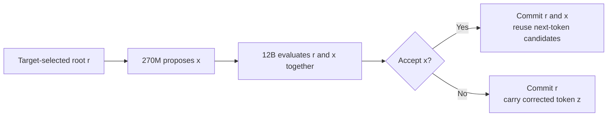
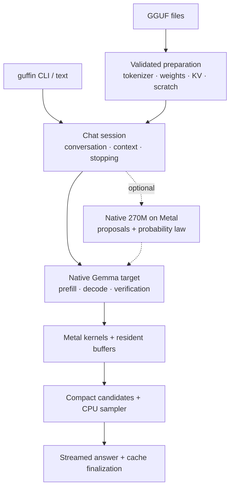
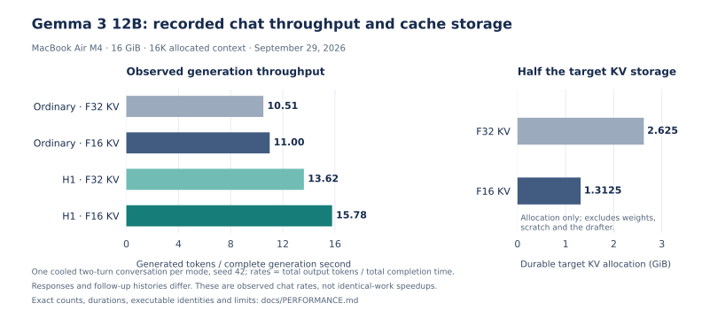

# Guffin

**Native Gemma inference for a fanless Mac.**

Guffin is a C++20 and Metal GGUF engine built for local chat on a **16 GiB
MacBook Air M4**. It owns model loading, tokenization, quantized kernels, caches
and sampling. **Gemma 3 12B** is the main target, with a native **270M drafter**
for lossless speculative decoding. **Gemma 2 9B** remains supported.

[Run](#quick-start) · [Design](#inside-the-engine) · [Results](#measured-results) ·
[Experiments](docs/SPECULATIVE_DECODING_RETROSPECTIVE.md) · [Code map](docs/GRAPH.md)

## Quick start

Install the Xcode Command Line Tools if needed: `xcode-select --install`.
Build and install:

```sh
git clone https://github.com/Coach6/guffin.git
cd guffin
make -j4 install
```

Download the [tested Gemma 3 12B Q4_K_M GGUF][target-model] into `models/`.
Chat is the default:

```sh
guffin -m models/gemma-3-12b-it-Q4_K_M.gguf
```

The command works from any directory; model paths may be relative or absolute.
Installation selects `/opt/homebrew/bin` when present, otherwise `/usr/local/bin`.
For a custom location, use `make install PREFIX="$HOME/.local"` and add
`$HOME/.local/bin` to `PATH`.

## Lossless speculative decoding

Download the [supported Gemma 3 270M Q8_0 checkpoint][draft-model] into
`models/`, then:

```sh
guffin -m models/gemma-3-12b-it-Q4_K_M.gguf \
  --draft-model models/gemma-3-270m-it-Q8_0.gguf
```

The retained **H1** path drafts one token and verifies two causal rows together,
sharing weight fragments across rows. Acceptance uses the target/draft
probability ratio; rejection uses a corrected distribution. This preserves the
configured target's sampling distribution, including its filters. It need not
produce identical seeded text.



Both outcomes select the next root without another target forward. Private KV
and transaction finalization preserve the committed prefix, restoring any
provisionally published suffix after stopping or interrupted callbacks. Larger
horizons did not earn a retained chat advantage.

## Inside the engine



The CLI adapts the engine session. Independent references, fault injection and
benchmark drivers stay outside the installed execution path.

### Where the speed comes from

Optimizations extend beyond speculation and match the actual Gemma shapes:

| Mechanism | Work saved |
| --- | --- |
| [Quantized weight packing](include/local_gguf_engine/tensor/kquant_packing.hpp) | Pack eight output columns once for SIMD access; two-row kernels reuse quantized fragments. No floating-point model copy. |
| [Producer-fused Q4 sums](src/engine/gemma_target_runtime.cpp) | Normalization, GELU and attention producers calculate reusable correction sums: Gemma 3 ordinary/H1 and Gemma 2 shared verification. |
| [Prompt matrix tiles](src/tensor/backends/metal/metal_command_context.mm) | Larger Gemma 3 tiles share decoded weights across more useful prompt rows, preserving F32 arithmetic. |
| [F16 KV and online attention](src/tensor/backends/metal/metal_kernels.mm) | Halve target KV storage; accumulate attention in F32 without a full decode score matrix. Local layers use bounded rings. |
| [Compact candidate selection](src/engine/sampling.cpp) | Keep vocabulary logits on the GPU; transfer compact candidates for configured CPU sampling. |
| [Gemma 2 weight preparation](src/engine/gemma2_metal_plan.cpp) | Requantize Q6 down weights to Q4 and the F16 head to Q8. This changes weights; Gemma 3 preserves native Q4/Q6 values. |

Persistent scratch, cached conversation prefixes and Metal residency support
repeated chat. Gemma 3's tied embedding/output head shares one allocation;
ordinary and speculative execution share the target block encoder.

[llama.cpp](https://github.com/ggml-org/llama.cpp) supports far more models and
hardware. Guffin specializes these Gemma paths for M4. Its contribution is the
native layout, scheduling and lifecycle integration of established algorithms,
with retention decided by correctness and actual chat measurements.

## Measured results



*September 29 development snapshot, macOS 26.6.2: one cooled, naturally stopping
two-turn conversation per mode, seed 42. Rates use complete generation time.
Different responses and histories make these observed throughputs rather than
identical-work speedups.*

| Retained change | Recorded result |
| --- | --- |
| Gemma 3 F16 target KV | **+4.64% ordinary / +15.87% H1** throughput; **half the KV storage**. Natural-stop workloads differ. |
| Gemma 3 packed projections | **+18.86% H1** throughput, matching outputs/counts; ordinary throughput −0.82%. |
| Gemma 3 M32 prompt tiles | **14–21% higher prompt throughput**, matching outputs; **9.48 s saved** across a long conversation. |
| Gemma 2 target kernel port | **16.51 → 16.85 tokens/s (+2.05%)**, matching outputs. Standard chat includes suffix retrieval. |

F16 H1 recorded **15.78 versus 11.00 tokens/s** ordinary: **43.52% higher
observed throughput**. The table covers separate experiments; gains do not add.
The saved llama.cpp baseline and faster manual comparisons have OS, timing and
weight-policy limitations. [Performance evidence](docs/PERFORMANCE.md) separates
those comparisons and records exact counts, durations and identities.

## Everyday use

Interactive replies show **prompt tokens/s**, **generation tokens/s** and
**internal TTFT**. Internal TTFT ends at the first selected token; visible text
can arrive later. Loading and startup warmup are separate.

```sh
# One answer; timings go to stderr
guffin -m models/gemma-3-12b-it-Q4_K_M.gguf -p "Explain unified memory." -n 128 --stats

# Gemma 2 chat
guffin -m models/gemma-2-9b-Q4.gguf

# Inspect without inference
guffin inspect models/gemma-3-12b-it-Q4_K_M.gguf
```

`-c, --context-size` sets capacity. `/help` lists chat commands; Ctrl+C stops a
reply and Ctrl+D exits at the prompt. Piped stdout contains answers.
`guffin --help` lists sampling and output options, `--help-all` includes
advanced diagnostics, and `--version` reports the compiled build identity.

## Support and limits

- **Validated setup:** M4 / 16 GiB, macOS 26.6.2, Apple clang 21 and Metal.
  Release builds target M4; other chips and OS versions are unvalidated.
- **Models:** tested Gemma 3 12B IT Q4_K_M, Gemma 2 9B IT Q4_K_M and the
  authenticated 270M Q8_0 drafter. Family names alone do not establish compatibility.
- **Context:** Gemma 3 defaults to 16K; larger target capacities are explicit
  and must fit model/device limits. The drafter caps paired execution at 32K.
  The tested Gemma 2 model declares 8K. `--context-shift` enables explicit shifting.
- **Memory:** recorded 16K F16 physical-footprint high-water was approximately
  **8.56 GiB ordinary / 9.05 GiB with the drafter**. Leave room for macOS.
- **Scope:** text-only Gemma 2/3. Gemma 4 is future work. Short authenticated
  numerical references pass; an independent 128-token natural-prompt comparison
  exceeds existing bounds for an unresolved reason. See the
  [retrospective](docs/SPECULATIVE_DECODING_RETROSPECTIVE.md#numerical-validation-has-a-boundary).

Models are separate downloads with their own terms. Installed inference needs
no Python environment, external inference framework or network connection.

## Development

```sh
make                      # optimized executable
make MODE=debug test      # native correctness checks
bash scripts/ci.sh        # native and Python repository checks
make release-test         # optimized correctness checks
make uninstall            # use the installation PREFIX, if customized
```

Checks cover independent equations, quantized layouts, lossless probability
laws, cache rollback, owner lifetimes and chat recovery. Optional checkpoint
references require their authenticated artifacts.

- [Engineering retrospective](docs/SPECULATIVE_DECODING_RETROSPECTIVE.md): retained mechanisms, rejected experiments and lessons.
- [Performance evidence](docs/PERFORMANCE.md): measured snapshots and protocol.
- [Code map](docs/GRAPH.md) and [principles](docs/ENGINE_PRINCIPLES.md): ownership and engineering contracts.
- [Current state](docs/NEXT_TASK.md): development handoff.

[target-model]: https://huggingface.co/ggml-org/gemma-3-12b-it-GGUF/blob/e5feec63a04a7a5f9b4128bf469781359d1a3b1a/gemma-3-12b-it-Q4_K_M.gguf
[draft-model]: https://huggingface.co/ggml-org/gemma-3-270m-it-GGUF/blob/e7647be17ae1108f2f605ed061ca0608b171afff/gemma-3-270m-it-Q8_0.gguf
