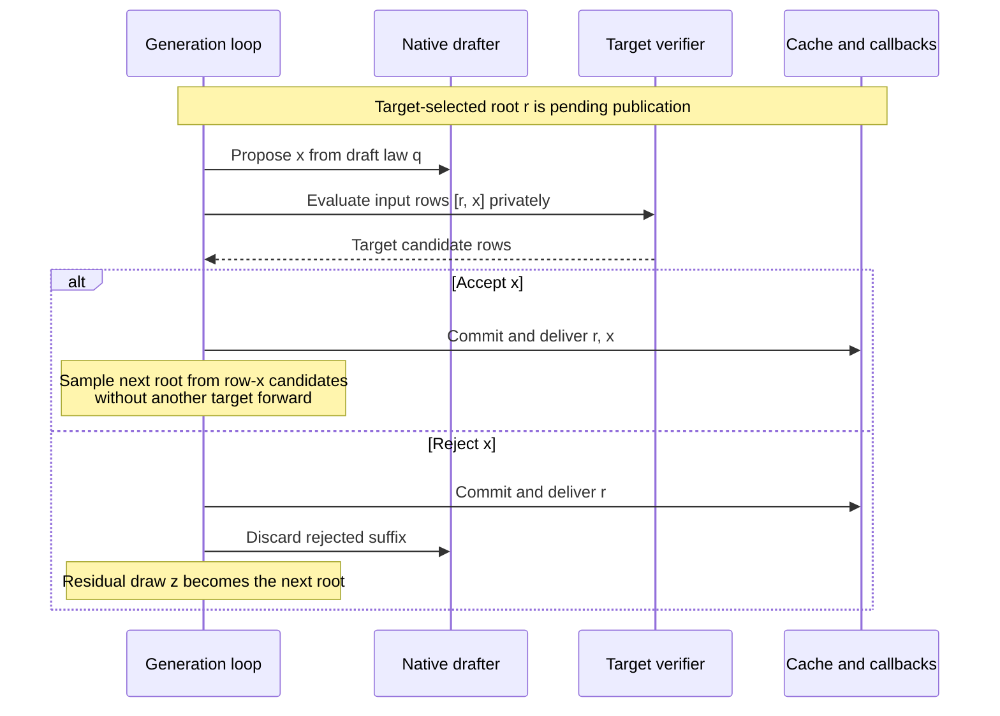

# Making Gemma inference faster on a MacBook Air

*An engineering retrospective, updated October 2026.*

Guffin began with a simple goal: faster local chat on a MacBook Air M4. Its
C++/Objective-C++ engine runs quantized Gemma models directly through Metal.
The useful changes eventually extended well beyond speculative decoding:
weight layout, reusable intermediate sums, cache precision and prompt matrix
tiles all mattered.

Gemma 3 12B now has a retained lossless H1 path using Gemma 3 270M. Earlier
learned drafters mostly lost, and the October Gemma 2 recurrent trial still
lost. Those results are compatible: a good prediction score, cheap drafter or
fast kernel alone does not establish faster chat.

This account explains what ran, what survived and why. [Performance evidence](PERFORMANCE.md)
contains the counts, clocks and comparison limits. The
[development archive](archive/DEVELOPMENT_HISTORY.md) preserves the fuller history.

## Retrieval worked before learned drafting did

The initial Gemma 2 9B Q4 engine generated roughly 16 tokens/s. A retrieval
drafter searched the current conversation for repeated token sequences and
suggested one continuation. A two-row target verifier checked it while
preserving ordinary seeded token choices and cache state.

The same 598 generated tokens took 37.233 rather than 38.293 seconds: 2.77%
less generation time. Only 26 speculative cycles ran, with 17 matches, but
retrieval was cheap enough to pay for itself. It stayed and remains the default
Gemma 2 path. Gemma 3 defaults to ordinary generation unless a drafter is supplied.

The early 17.5-token/s weight-streaming estimate described ordinary one-token
generation, not a hardware ceiling. Sharing a weight pass across useful tokens
can exceed it; paying to verify rejected tokens can make the engine slower.

Compact learned heads initially looked hopeless: 6.19% validation acceptance.
An audit found duplicate inverse-square-root scaling, shrinking feature-path
gradients sixteenfold relative to output bias. Repairing it and using AdamW
raised acceptance to 22.20%. Float and quantized results were similar, and
training fit still failed to generalize. The tested representation remained
unhelpful; the original broken training run had not rejected the architecture.

## What the learned and downloaded drafts established

Arm R was a recurrent drafter conditioned on target features and previous
draft tokens. Three seeds of one configuration were trained on 2,415 traces,
100,000 training origins and 83,340 validation origins, each for six epochs
and 37,500 updates. Its best H3 accepted-prefix scores were about 0.802,
0.802 and 0.791 **out of three**, not 80% acceptance.

Live exact-match H3 accepted about 0.37 draft tokens per cycle and fell from
16.11 to 8.28 tokens/s. Reusing those weights with lossless sampling reached
about 0.42 accepted tokens per cycle, but only 8.50 versus 15.83 tokens/s.
The weights were not retrained for the changed sampling objective. Neither
trial justified retention.

Arm P reached offline equations, gradients and a five-feature target interface.
Its proposed full-width backbone had approximately 1.19 billion learned
parameters; weights, gradients and Adam state exceeded 17 GiB before
activations. No full-size training or native chat run happened. This was a
resource constraint, not a measured speed failure.

Downloaded models provided complete, testable alternatives. Vicuna-68M needed
a tokenizer bridge and independent draft positions, following
[heterogeneous-vocabulary speculation research](https://arxiv.org/abs/2502.05202v3).
It averaged 0.54 accepted tokens per cycle and ran at 14.82 versus 15.98
tokens/s. Approximately 4.55 ms of draft GPU work could not offset roughly
98 ms of target verification.

Gemma 3 270M, with all 18 layers and its 262,144-token vocabulary, initially
drafted for **Gemma 2**. H3 averaged 1.42 accepted tokens per cycle, but a
15.13-to-15.41-token/s first screen did not survive the follow-up and retention
gate. A later sweep reached 15.37 against 15.91–16.03-token/s baselines.
H6 raised acceptance to 1.64 but slowed to 13.28 tokens/s; its sixth proposal
reached a decision in only 26 of 220 cycles. Conditional H3 verification
achieved 15.37 versus full verification's 11.94 with identical outputs and
acceptance. Longer drafts bought work that often went unused.

These were separate screens with separate baselines. They neither rank every
possible drafter nor predict the later Gemma 3 target result.

## Lossless H1 needed a real transaction

Lossless speculation preserves the selected target sampling distribution,
rather than the same seeded sentence. It accepts draft draws using the
target-to-draft probability ratio and samples a residual distribution after
rejection, as described by
[Leviathan and colleagues](https://proceedings.mlr.press/v202/leviathan23a.html).
The correction must use the draft sampler's actual finite integer probability
law and the engine's filtered target law, rather than an idealized softmax.

The retained Gemma 3 H1 cycle checks one proposal beside a target-selected
root. Its publication boundary matters:

Target candidate extraction runs on the GPU; final target sampling runs on the
CPU. The drafter supplies its actual proposal masses. Accepted target rows are
published from private KV without replay, and an unused pending draft token
does not require a wasteful forward pass. Selected private rows are
provisionally scattered before callbacks; finalization restores any suffix
beyond callback receipts.

Rollback restores physical cache bits, draft state, sampler checkpoints and
history to consistent prefixes. Moving a position counter alone is insufficient.
Callback delivery is an irreversible boundary; recovery must respect what the
caller already received. Invalid numerical state cannot simply be declared
healthy again. These ownership rules made H1 usable across stopping, rejection,
regeneration and interruption.

## Weight sharing made the Gemma 3 verifier useful

The Gemma 3 body originally used canonical Q4/Q6 blocks. Lossless execution
packing rearranged their quantized values so adjacent lanes access adjacent
column pairs. Preserving each worker's reduction order and transposing the
final results mattered: the first lane assignment regressed.

Packing increased resident weights by about 143 MB. It did not create a
floating copy of the model; the tied Q6 embedding/output head remained one
canonical allocation. More than 30 million checked projection outputs were
bit-exact, and checkpoint and continuation checks retained their original bounds.

In the matched cooled comparison, H1 aggregate generation rose from 9.269 to
11.017 tokens/s, an 18.86% gain with identical generated counts and hashes.
Ordinary generation fell 0.82%, within the regression guard. The change earned
its place by improving the actual verifier, rather than every execution mode.

Producer-fused input sums then reused arithmetic needed by Q4 minimum
corrections. Normalization, GELU and attention-output producers calculate those
sums while values are already available; projection consumers reuse them
without another dispatch or wait. Addition order remains unchanged.

An early screen missed the follow-up TTFT guard. Later matched personal-chat
measurements were mixed: one 900-token turn fell from 60.63 to 55.71 seconds,
while a 1,048-token turn regressed slightly. Aggregate improvement across the
three measured turns was 3.82%, and the change was retained. A much larger
earlier comparison used a historical baseline and does not isolate this
mechanism's causal gain.

## Smaller target caches helped both modes

Gemma 3 F16 target KV halves durable cache storage. Keys are projected, normalized and
rotated in F32 before storage; values are rounded at storage too. Attention
reads the rounded values even for private proposal rows, while accumulation,
softmax, activations and projection math remain F32. The drafter keeps F32 KV.
Publication and undo preserve stored bits, without an F32 cache mirror.

At a 16K allocation, durable target KV fell from 2,818,572,288 to
1,409,286,144 bytes. Including private and undo storage, owned allocations
saved about 1.37 GiB in both ordinary and H1 modes.

Independent rounding checks covered 393,216 value stores and 98,304 key stores.
A filled-context comparison checked 32 teacher-forced positions through 16K:
maximum logit change was 0.01751 and mean NLL changed by +0.00004049 nats/token.
One argmax changed. This was numerical sensitivity evidence, not a broad
answer-quality evaluation.

Using generation-completion clocks, cooled ordinary throughput rose from
10.508 to 10.996 tokens/s (+4.64%); H1 rose from 13.620 to 15.781 (+15.87%).
F16 H1's observed aggregate rate was 43.52% above F16 ordinary. These runs
produced different natural-stop text, lengths and follow-up histories, so none
of these percentages is an identical-work speedup or a universal promise.
F16 also changes the numerical target: lossless H1 preserves its sampling law,
not the previous F32 distribution. Explicit F32 remains available.

## Ordinary inference still deserved attention

M32 prompt tiles reuse decoded weight tiles across more real rows while
preserving F32 arithmetic. All seven actual matrix geometries matched M8
bit-for-bit. In a cooled long chat, 2,018 and 1,349 newly evaluated prompt
tokens took 31.66/23.92 rather than 36.18/28.89 seconds: prompt throughput
improved 14.27%/20.74%, with identical selected-token hashes. M32 stayed for
at least 32 useful rows. M16 increased short-chat TTFT by about 3.9% and was
removed; 4–31 useful rows retain M8, and 1–3 use compact kernels. Scalar
decode did not change.

Several complete alternatives failed screening:

- Cooperative gate/up/GELU fusion preserved exact outputs and removed 96
  dispatches and 48 barriers, but full-target time changed from 80.245 to
  80.467 ms. Dispatch count was not the bottleneck it appeared to be.
- Double-buffered prompt lookahead preserved ordering and overflow checks.
  However, a 2,048-token baseline prompt spent only 0.075% outside GPU
  execution. The available host overlap could not justify its extra owners.
- Native 32-value Q4 workers and shuffle-based H1 reductions passed correctness
  but reduced matched chat throughput from 15.042 to 13.384 tokens/s. Fewer
  apparent operations did not guarantee a faster prepared stream.
- Blocked F16 global attention shared KV across paired query rows and GQA
  heads. It saved 4.53 ms at 8K and 8.63 ms near 16K in isolated target work,
  but matched long-chat H1 throughput fell from 9.379 to 9.271 tokens/s.
  It was removed; 32K/64K chats were not measured.

## Numerical validation has a boundary

A separate prompt-attention rewrite failed independent 16-token numerical
bounds where the baseline passed. A new 128-token oracle also exposed a
baseline failure under the existing bounds. Its cause remains unresolved;
matching top-1 predictions does not waive it. The retained M32 projections are
bit-identical and did not introduce that gap.

## The Gemma 2 transfer remained a bounded win

October's Gemma 2 target port reused compact Q4 projections and producer-owned
sums in shared verification/retrieval, without changing its prompt schedule or
original Q6 value arithmetic.
Variants changing those boundaries failed parity and were discarded. The
retained target matched continuation logits and all 42 layers' KV exactly.

Default retrieval generation improved from 16.511 to 16.849 tokens/s (+2.05%)
for the same 598 tokens and hashes. Gemma 2 still requantizes Q6 down matrices
to Q4 and its F16 output head to Q8; this is not an unchanged-GGUF quality claim.

The complete width-512 Arm R H1 candidate passed independent distribution,
cache and lifecycle checks. Only seed1 with the Q8 draft head was measured
live. It accepted 104/411 proposals (25.30%) and reached 15.145 tokens/s,
10.11% below the updated target on different natural-stop responses.
Measured draft and verification costs suggested roughly 41% acceptance merely
to break even. The target port stayed; recurrent integration was removed.
That rejects this checkpoint and execution path, not every possible recurrent
proposal law.

## What the measurements justify

The retained work improves useful weight reuse, removes repeated arithmetic,
reduces cache storage and speeds actual prompt processing. Correctness checks
protect state as well as logits. Rejected mechanisms leave evidence rather
than inactive production machinery.

Most cooled results are individual paired conversations, not confidence
intervals. Natural stopping changes workloads; system-wide swap counters do
not identify engine paging, and absent thermal warnings do not establish equal
GPU clocks. Generation-completion time includes publication and callbacks;
internal TTFT and first visible text measure different boundaries.

The durable lesson is to test the complete mechanism against the complete
experience. Acceptance, draft cost, verification cost, latency and memory must
work together. Keep a gain attached to its measured scope, and keep a failure
attached to the implementation that actually failed.
