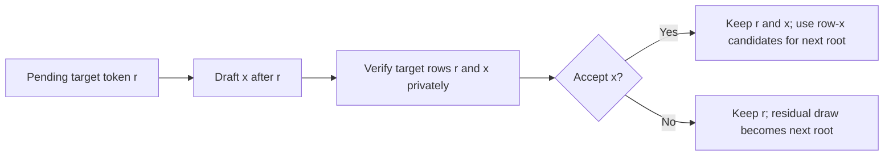

# What it took to make Guffin faster

*An engineering retrospective, June–October 2026. Updated October 14, 2026.*

Guffin began as a from-scratch GGUF engine with a practical goal: make local
chat faster on a MacBook Air M4. We wanted to own the inference path, understand
where the time went, and improve it without handing execution to another
runtime. That meant building the model loader, tokenizer, numerical kernels,
sampling and conversation state, then making them work together on Metal.

The result is a native Gemma 3 12B engine with a useful lossless speculative
path using Gemma 3 270M, alongside the retained Gemma 2 9B path. Getting there
required more than finding a small model that could guess the next token.
Several learned drafters failed. A complete Gemma 3 pairing initially lost to
ordinary decoding. Some faster kernels made chat slower. Some experiments
exposed correctness problems in the foundations they were meant to accelerate.

The most useful thread through the project is **cost per useful token**. Better
predictions, fewer GPU launches and less allocated memory each mattered only
when they improved the complete conversation. The successful changes shared
weights profitably, reused arithmetic already being computed, reduced cache
storage and accelerated real prompt processing. The unsuccessful changes
helped establish where those opportunities ended.

This is an account of those decisions, including mistakes and unfinished work.
The measurements below are historical development evidence. A cooled comparison
means fresh processes with at least four minutes idle before each run, unless
the section says otherwise. The three final release campaigns are now complete;
[performance evidence](PERFORMANCE.md) records their results, clocks and limits
separately from these development snapshots.

Follow the story through the [foundations](#first-make-the-model-mean-what-it-should),
[Gemma 2 experiments](#retrieval-was-a-small-win-worth-keeping),
[Gemma 3 verifier](#a-correct-speculative-pipeline-still-lost), and
[lessons](#the-threads-that-connect-the-results).

## Reading the experiments

**Prefill** evaluates the prompt; **decode** generates the answer. The **KV
cache** stores earlier tokens' attention keys and values so the model does not
recompute them. A **drafter** proposes tokens cheaply; the larger **target**
checks them. **H1** proposes one token per speculative cycle, while **H3**
proposes up to three. Verification includes a pending target token, so those
paths normally evaluate two and four target rows respectively. Q4/Q6 are
quantized weight formats; F16/F32 refer to 16-bit and 32-bit floating-point
precision. Repacking the same weight values differs from rounding them to
a lower precision.

We changed the correctness contract during development. Early speculation
preserved ordinary seeded token choices. Later **lossless sampling** preserved
the target's sampling distribution, allowing a different sentence from the
same seed. Lossless does not mean every answer is equally good, nor that
changing cache or weight precision leaves the model numerically unchanged.
It means speculation introduces no change to the configured target law.

The distinction between a proposal, a component experiment and a complete
implementation also matters. A failed prototype only tells us about the part
it tested. A faithful implementation can still fail performance. An untrained
or unfinished design has no measured chat result. The archives also contain
research-only ideas—fixed-function weight decoding, certified vocabulary
search, proposal trees and scale-folded matrix verification. Their presence
in a plan is not evidence that they were built or failed.

## First, make the model mean what it should

The June history starts with GGUF parsing, tensor storage and CPU equations.
Those pieces led to working output, then coherent Llama-family answers, before
the first explicit Metal-backed generation route. GPU residency developed
incrementally: first individual operations, then cache-aware blocks, then
weights and intermediate state kept on the device between layers. By late June
there was a reusable quantized Gemma plan; July's repeated layer implementations
became a common block loop.

One early correction was fundamental: GGUF/GGML matrices store their first
axis contiguously. Embeddings and projections had to address that layout
correctly. A program producing tokens was not evidence that it interpreted
every tensor correctly.

Gemma chat later exposed three separate causes of collapsed output: RoPE used
adjacent coordinate pairs instead of Gemma's split-half rotation; SentencePiece
encoding mishandled spaces and produced unknown tokens; and fast Metal `tanh`
could make ordinary GELU gates nonfinite. The response was to pause performance
tuning and check token IDs, logits and stable arithmetic. Changing the sampler
to make those outputs look better would have hidden a bad forward computation.

Byte fallback, sampling order, chat formatting, natural stopping and context
handling followed. These were part of the model's behavior, rather than polish
to add after the kernels worked. A fast answer to a differently tokenized
prompt is a different experiment.

That lesson kept returning: a plausible answer can survive a numerical or
state error. Independent equations, discriminating fixtures and explicit
contracts were needed before the text itself became useful evidence.

*Evidence: the [first layout correction](https://github.com/Coach6/guffin/commit/19751ff),
[Gemma chat repair](https://github.com/Coach6/guffin/commit/71a989d), and
[shared block loop](https://github.com/Coach6/guffin/commit/783b496).*

## Ordinary inference set the economics

The ordinary Gemma 2 engine improved through resident execution, native Q4/Q6
projections, online attention, grouped-query reuse, compact GPU candidate
selection and tiled prompt projections. Online decode attention maintained the
softmax result without storing a full attention-score matrix. Compact candidate
readback avoided bringing the full vocabulary to the CPU every token.

Memory and lifetime work mattered too. Local-attention layers only needed their
bounded windows, rather than a full-context cache each. Proven dead prompt
buffers could share storage. Terminal work could omit an unused output head
when stopping was known before encoding; callback stops still had to preserve
GPU-success-before-delivery ordering. Streaming moved from repeatedly decoding
the whole prefix to appending decoded tokens with boundary-aware stop matching.

Gemma 2 also adopted explicit numerical policies: F16 KV, Q6 down projections
requantized to Q4, and an F16 output head requantized to Q8. Those choices
reduced traffic, but changed the executed numerical model. They must remain
visible when comparing quality or performance with another engine loading the
same GGUF file.

Storage alternatives were tested too. Advice to discard mapped file pages did
not release the expected resident payload; file-backed no-copy weights and
alternative Metal storage policies did not earn retention. Sustained no-copy
access regressed, so copied resident weights stayed. A smaller nominal copy
count did not establish lower useful inference cost.

By August, short-context Gemma 2 chat was already around 16 tokens/s in the
recorded conversations. Whole-path audits pointed to weight traffic as a major
constraint, with the feed-forward matrices and large vocabulary head accounting
for much of it. A coarse 17.5-token/s estimate assumed one full-file read per
token at peak bandwidth. It described that execution pattern; it was not a
hardware ceiling for methods that reused a weight pass across several tokens.

That made speculation appealing. Instead of only making one token cheaper,
we could try to make one expensive target pass produce more useful tokens.
But isolated projection timings initially made wider verification look more
favorable than sustained streams did. Repeated measurements corrected that
assumption: two rows were promising, while increasing row count could cross
into a much less efficient kernel family.

*Evidence: the archived [whole-system opportunity audit](https://github.com/Coach6/guffin/blob/4579c7f/docs/DECODE_RESEARCH_PROGRAM.md#phase-2-local-whole-system-opportunity-audit),
[sustained kernel investigation](https://github.com/Coach6/guffin/blob/4579c7f/docs/DECODE_RESEARCH_PROGRAM.md#phase-3-decode-pipeline-and-kernel-deep-dive),
and [completed memory/storage trials](https://github.com/Coach6/guffin/blob/4579c7f/docs/DECODE_ACCELERATION_MASTER_PLAN.md).*

## Retrieval was a small win worth keeping

The first retained speculative proposer searched the conversation for repeated
token sequences and suggested a continuation. It needed no second neural model.
A two-row target verifier checked the suggestion while preserving ordinary
seeded token choices and cache state. A profitability gate avoided paying for
verification when retrieval was unlikely to help.

In the cooled two-turn comparison, the same 598 generated tokens took 37.233
rather than 38.293 seconds: **2.77% less generation time**. Only 26 speculative
cycles ran, with 17 matches. Retrieval worked because its lookup was cheap,
not because it supplied long accepted drafts on every step.

This became Gemma 2's retained default. It also made later learned drafting
harder: a learned source running after retrieval inherited the less predictable
positions that retrieval had not already handled. Acceptance on an unrelated
corpus could not establish performance on that remaining workload.

The verifier exposed correctness issues along the way. An initial comparison
needed a corrected numerical adjudication and uncovered fused normalization
row indexing. A nonzero-weight wrap test then showed that writing a later row
into a full local ring could destroy an older key still needed by an earlier
query. Preserving causal store order fixed the two-row case. Later chunked
prefill staged new KV privately, performed attention, and published afterward.

These fixes survived the experiments that found them. The project gained both
a small speedup and a more trustworthy cache mechanism.

*Evidence: [retained retrieval, transaction and matched comparison](https://github.com/Coach6/guffin/blob/e525bca/docs/NEXT_TASK.md#retained-stage-4-implementation),
plus the [wrapped-prefill correction](https://github.com/Coach6/guffin/commit/cd49f53).*

## Learned heads: first repair the experiment, then judge it

The early compact head combined target features with a small factorized output
projection and a mapped vocabulary. Its initial validation proposal acceptance
was only **6.19%**. That looked like a strong rejection, until an audit found
an extra inverse-square-root scaling factor that shrank feature-path gradients
sixteenfold relative to the output bias.

Removing that factor and replacing plain SGD with AdamW first passed a
small memorization check. The repaired model reached **22.20%** validation
acceptance, with similar float and Q4 results. Quantization had not caused the
original collapse. Training fit improved much more than validation, however,
and replay still lost even when draft cost was set to zero. Scaling, optimizer
and training duration changed together, so their individual contributions
were not isolated. Correcting the
implementation reopened the question; it did not make the tested representation
useful.

There were several plausible limitations: sparse evidence for the mapped
vocabulary, few conversations, randomly learned output factors and one-step
teacher conditioning. The result did not isolate each cause. It did establish
that this repaired checkpoint could not repay its verifier cost.

A separate broad-head effort, called **Stage 5R** in the archive, went much
further into native integration. It built causal feature capture, authenticated
artifacts, CPU/Metal proposal execution and shared live/replay transitions.
Its dense 256K and mapped 32K vocabulary heads passed structural and memory
checks, but warm proposal costs were roughly 7.26 and 5.81 ms, above their
2 ms feasibility budget.

**Those new broad heads were never trained.** The cost screen stopped the
experiment before its frozen training corpus was collected. With that verifier
and mapped head, even perfect acceptance gave an optimistic eligible-cycle
ceiling around 1.40×, before uncovered positions and other costs. That bound
rejected the ambitions of that design, not the quality of nonexistent weights
or a universal ceiling on speculative decoding.

In hindsight, this phase built more training and admission machinery than was
needed to discover the execution-cost problem. Faithful implementation was
valuable; expanding the surrounding infrastructure before the hardware gate
paid off was less valuable.

*Evidence: [compact-head repair and replay](https://github.com/Coach6/guffin/blob/e525bca/docs/NEXT_TASK.md#archived-compact-head-result-and-controlled-reopening)
and the [Stage 5R postmortem](https://github.com/Coach6/guffin/blob/063e6f6/docs/STAGE5R_SPECULATIVE_DECODING_POSTMORTEM.md).*

## Compressing the output head taught a different lesson

A related investigation asked whether a rank-256 representation could reuse
Gemma 2's output-head knowledge instead of learning a compact vocabulary head
from scratch. Here, rank 256 meant compressing the hidden-state-to-vocabulary
mapping through 256 latent coordinates. Full-head controls reconstructed the
teacher closely, checking that trace joining and head interpretation were not
the source of the compact representation failures.

Compressing the head matrix on its own with singular-value decomposition
(SVD) failed before recurrent drafting: even its F32 representation lost too
much information. Q4 packing made it worse, but was not the original
cause. Activation-weighted principal component
analysis (PCA) and reduced-rank regression then used actual target states to
preserve more relevant behavior.

The regression result looked excellent by one familiar metric: it retained
**99.675% of raw-logit energy**. It still failed sampler-facing checks, including
on training states. Much of that energy lived in a dominant common mode;
preserving it did not preserve the small distinctions that determined token
selection. Gemma's nonlinear output softcap also meant a raw vocabulary-wide
shift could not simply be discarded as though it were an ordinary softmax
invariance.

Sampler-aligned fitting improved the objective. A later free-head continuation
preserved Adam state across a full 512-epoch schedule and fitted the small
training cohort well: **86.56% sampled-token match on 1,024 training states**.
Untouched conversation validation reached only **45.04%**, against **87.39%**
for the full-head oracle. The fitted per-state codes and their subsequent linear
realization had memorized an underdetermined training system.

A prior-anchored diagnostic tested a real architectural concern: minimum-norm
realization had discarded useful information outside the fitted states' span.
Keeping that prior helped on a same-conversation complement by about 1.60
percentage points, but remained far below the gate. This corrected an avoidable
loss without rescuing the checkpoint; that complement was not a new holdout.

The investigation ruled out these representations and fitting procedures.
It did not prove that rank-256 nonlinear drafters were impossible. Its lasting
lesson was narrower and more useful: raw-logit reconstruction, tiny-cohort
memorization and on-conversation improvements were inadequate substitutes for
held-out proposal behavior under the actual sampler.

*Evidence: [the rank-256 history](https://github.com/Coach6/guffin/blob/e525bca/docs/NEXT_TASK.md),
especially the persistent continuation and prior-anchored diagnostic.*

## Recurrent and parallel drafts had different outcomes

The September research drew on target-conditioned drafting, including
[ReDrafter](https://arxiv.org/abs/2403.09919) and
[EAGLE-3](https://arxiv.org/abs/2503.01840). The implemented **Arm R** was a
Gemma-specific recurrent transfer, not a source-exact reproduction of either
project. The trained configuration used a width-512 gated recurrence,
the final-normalized target feature and previous draft tokens, with a
full-vocabulary F16 head and deployment-prefix training on its own rollout.

Data preparation mattered. An initial 112 GB capture contained valid traces,
but lacked the balanced membership required for this control. Capturing only
the feature the selected model actually consumed reduced feature payload by
44× without changing its inputs. The completed collection contained 2,415
traces, 100,000 training origins and 83,340 validation origins. Three seeds
completed six epochs and 37,500 updates each.

Their best offline H3 accepted-prefix scores were about **0.802, 0.802 and
0.791 out of three**. Those figures were expected prefix lengths, not 80%
acceptance. Live seed1 exact-match H3 accepted about 0.37 draft tokens per cycle
and ran at 8.28 versus 16.11 tokens/s. Applying lossless sampling to the same
weights reached about 0.42 accepted tokens, but only 8.50 versus 15.83 tokens/s.
The weights were not retrained for the changed sampling objective. These were
separate screens with different histories and memory pressure, not a controlled
8.28-to-8.50-token/s gain from changing the sampler.

Both proposal behavior and execution economics were unfavorable in those
screens. An offline score did not establish the origins the live controller
would visit, the survival of later edges, or whether the entire cycle would
beat the target.

**Arm P** explored a different mechanism: one parallel backbone predicting a
block, followed by sequential correction. Its offline equations, gradients and
five-feature target interface were independently implemented and tested from
the pinned source design. Source-checkpoint and scheduler goldens remained open.
The full-width Gemma transfer contained roughly **1.19 billion
learned parameters**; F32 weights, gradients and Adam moments alone required
**17.68 GiB**, before embeddings and activations.

No full-size allocation, training or native Arm P chat happened. No smaller
substitute was used to claim the intended architecture had failed. This was
unfinished work with a resource obstacle. Most other families in the large
research registry also remained planned work, rather than completed experiments.

*Evidence: the archived [training and integration record](https://github.com/Coach6/guffin/blob/4579c7f/docs/NEXT_TASK.md),
including “Lossless R-chain implementation checkpoint,” “Arm P implementation
checkpoint” and the earlier H3 live handoff.*

## Downloaded drafters tested the complete alternative

Standalone pretrained models avoided the need to train a new proposal model,
but brought different compatibility costs.

Vicuna-68M required a tokenizer bridge and separate draft positions. Target and
draft tokens could not be treated as interchangeable just because both decoded
to text. The native implementation averaged about 0.54 accepted tokens per
H3 cycle and reached **14.82 versus 15.98 tokens/s**. Roughly 4.55 ms of draft
GPU work did not repay about 98 ms of verification.

The existing Gemma 3 270M drafter was then paired with **Gemma 2**, before a
Gemma 3 target existed. This was the real 18-layer model, not a shortened proxy.
Its first F16-cache attempt exposed F32 reduction differences that crossed half
rounding boundaries; keeping drafter KV in F32 preserved its reference contract
without loosening tolerances. H3 averaged 1.42 accepted tokens per cycle. An
initially encouraging first screen did not survive the follow-up and retention
decision. A later sweep
reached 15.37 tokens/s against 15.91–16.03 baselines.

H6 increased accepted drafts to 1.64 but fell to 13.28 tokens/s. Its sixth
proposal reached a decision in only 26 of 220 cycles. Conditional verification
was much cheaper than full verification for one matched H3 run—15.37 versus
11.94 tokens/s with the same output and acceptance—but still did not establish
a retained improvement over the target.

These results concerned separate checkpoints, baselines and execution paths.
They showed that later proposals often went unused, and that token mapping and
verification strategy mattered. They did not predict what the same drafter
would do with a newly implemented Gemma 3 target.

Verifier experiments also had distinct outcomes. A four-row F32 sharing path
passed correctness but regressed live chat; a requested repeat reproduced that
loss. A later paired-row pass showed a narrow same-output improvement over its
own speculative baseline. We withdrew that pass before establishing promotion
over default retrieval. Restoring the preserved baseline
kept that experiment separate from the next target implementation.

*Evidence: archived [Vicuna implementation](https://github.com/Coach6/guffin/blob/4579c7f/docs/NEXT_TASK.md#native-vicunatli-implementation-and-verification),
[Gemma 3-to-Gemma 2 integration](https://github.com/Coach6/guffin/blob/4579c7f/docs/NEXT_TASK.md#previous-gemma-3-integration-baton-completed),
[horizon sweep](https://github.com/Coach6/guffin/blob/4579c7f/docs/NEXT_TASK.md#completed-draft-lengthcalibration-screen-2026-09-19),
and [withdrawn verifier pass](https://github.com/Coach6/guffin/blob/4579c7f/docs/NEXT_TASK.md#withdrawn-verifier-optimization-historical-contract-and-evidence).*

## Gemma 3 required explicit architectural differences

After the September cleanup, the target became the downloaded Gemma 3 12B
instruction-tuned Q4_K_M file. Inspection established its actual contents:
48 layers, mixed Q4_K/Q6_K body weights and a tied Q6 embedding/output head.
The file contained language-model tensors, not a vision encoder. Text chat was
the scope, regardless of image markers in the vocabulary.

Gemma 3 required explicit Q/K head normalization, five local-attention layers
per global layer, different local/global position behavior, global RoPE scaling,
four block norms and absent softcaps. Shared model-family membership did not
prove target/draft compatibility. The two files matched all token strings and
scores, but two image-marker token types differed. Direct token-ID mapping
needed an authenticated exception for those known differences, rather than
removing validation wholesale.

We reused the GGUF loader, resident weights, sampling, sessions, verifier and
rollback foundations. A shared transformer encoder served ordinary prefill,
decode and verification, with explicit family differences. Building a second
engine would have duplicated the lifecycle work that earlier experiments had
already made difficult.

The initial target used F32 activations, accumulation and KV. Prompt matrix
projections retained F32 operands; continuation used packed arithmetic.
Independent checkpoint equations checked complete vocabulary logits and all
layers' KV across prompt, continuation, verification and rollback. A separate
small model fixture exercised wrapped local windows. Those checks validated the
tested cases, rather than arbitrary-context
numerical equivalence.

The first ordinary pipeline work reduced prompt/head work and attention
launches. Its matched historical chat improved from roughly **9.71 to
10.34 tokens/s**, with unchanged selected-token hashes. A later broad workspace
rewrite passed correctness but regressed chat and was removed. Verifier-scoped
undo sizing and backup synchronization survived, reducing scratch without
claiming an ordinary speedup.

*Evidence: [artifact and architecture research](archive/DEVELOPMENT_HISTORY.md#2-actual-artifacts-and-machine),
[implemented target](archive/DEVELOPMENT_HISTORY.md#implemented-target-boundary-and-current-verification),
and [pipeline decisions](archive/DEVELOPMENT_HISTORY.md#completed-baton-native-gemma-3-pipeline-optimization).*

## A correct speculative pipeline still lost

The first complete Gemma 3 12B + 270M integration already included the real
drafter, compact proposal sampling with a full fallback, pending-token handling,
lossless correction, context admission and cache recovery. It accepted roughly
**68%** of H1 proposals on the first turn and **60%** on the follow-up, yet
cooled aggregate generation was **3.56% slower** than ordinary decoding.

Verification occupied about 92% of the measured cycle time. That did not mean
verification was intrinsically doomed: the target was expected to be much more
expensive than a 270M drafter. The question was whether one verification cycle
produced enough useful tokens to repay its cost.

For steady H1 cycles, a useful approximation is:

```text
speedup ≈ ordinary token time × (1 + acceptance probability)
          / (draft time + verification time + other cycle work)
```

Stopping, budgets, synchronization and changing context complicate the actual
chat. The formula still explains why comparing verification only with drafting
is misleading: it must be compared with the ordinary passes that the cycle
replaces.

An audit found and fixed a real first-token publication delay. The first
ordinary token could be delivered before synchronizing the drafter, while the
deferred work still belonged in total generation time. But there was no
duplicate target forward, replay of accepted prefixes or useless final draft
forward waiting to be deleted. Host cleanup alone could not rescue the main
cost.

### What lossless H1 actually commits

For a draft draw `x`, the standard correction accepts with probability
`min(1, p(x)/q(x))`; after rejection it samples from normalized
`max(p−q, 0)`. Here `p` is the configured target distribution and `q` is the
actual proposal law. This follows
[Leviathan and colleagues](https://proceedings.mlr.press/v202/leviathan23a.html).
Guffin uses the drafter's emitted finite integer-CDF masses, rather than
pretending its draw came from an ideal softmax. Target filters and repetition
history also belong to the law being preserved.

The retained schedule starts with a target-selected token `r` pending cache
publication. The drafter proposes `x` after `r`, and the target evaluates
`[r, x]` in private storage:



The diagram assumes no stop or callback interruption. Selected rows are
provisionally copied into durable KV before callbacks; finalization retains
only the delivered prefix and restores the suffix. Accepted rows are published
without target replay. Rejected draft state is rolled back, and the last draft
token can remain pending until a forward pass is actually needed.

A correct probability formula cannot repair an incorrect cache. Recovery must
restore physical KV bits, sampler history, random state and draft frontier to
consistent prefixes. A callback's delivered output cannot be taken back.
Regeneration must also replay the original prompt/decode segment boundaries,
because changing batching can change F16 rounding and cache state.

*Evidence: [initial pairing](archive/DEVELOPMENT_HISTORY.md#historical-completion-record-native-gemma-3-speculative-integration),
[performance audit](archive/DEVELOPMENT_HISTORY.md#previous-state-speculative-performance-audit-completed),
and [lossless probability tests](../tests/engine/lossless_sampling_tests.cpp).*

## The decisive change was how the verifier read weights

Early sharing and fixed-shape kernels did not settle the problem. Some
weight-sharing implementations were slower; a later shared projection path
helped ordinary generation, but H1 still lost the follow-up. Its comparison
had to use the improved ordinary path, not the older slower baseline.

The retained change repacked body Q4/Q6 weights for Metal execution. Neighboring
lanes read neighboring column pairs, then a final transpose restored logical
workers and their original reduction order. Packing alone was insufficient:
the first version kept the old lane assignment and regressed.

The conversion preserved quantized values rather than creating a floating-point
copy of the model. It added about **143 MB** of resident weights; the tied Q6
embedding/output head remained one allocation. More than **30 million** checked
projection outputs were bit-exact.

The cooled before/after H1 comparison preserved generated tokens, hashes,
proposal counts and accepted drafts. Aggregate throughput increased **18.86%**,
from 9.269 to 11.017 tokens/s. Verification/publication GPU time fell about
23.47% on the first turn and 13.71% on the follow-up. Ordinary aggregate
throughput was 0.82% lower, within its guard.

This is the clearest causal result in the speculative story: **the same drafter
became useful without better acceptance**. Execution layout had been a major
obstacle. That does not assign every timing difference to the new kernel—the
unchanged drafter's follow-up time varied—but the matched useful work makes
the result stronger than a cross-mode comparison with different answers.

Producer-fused Q4 correction sums removed another repeated operation.
Normalization, GELU and attention-output kernels calculated the sums while
values were already available; projection consumers reused them with the same
addition order. There was no separate sum-preparation launch or host wait. This
covered ordinary
scalar and H1 projections; prefill, Q6 and H3 were unchanged in that adoption.

Its evidence was less clean. An early historical-baseline comparison showed a
large gain, but the unchanged drafter also sped up and follow-up TTFT missed
the guard. Later personal matched chats showed a **3.82% aggregate improvement**
over three turns, including one slight regression. Those were not a controlled
thermal study. We adopted the tested fused-sums implementation as the baseline;
the large earlier percentage is not its isolated causal gain.

*Evidence: [compact packing and matched chat](archive/DEVELOPMENT_HISTORY.md#retained-baseline-compact-projections)
and [fused-sums adoption](archive/DEVELOPMENT_HISTORY.md#current-state-accepted-fused-sums-h1-baseline-2026-09-28).*

## H3 was implemented, but more rows did not repay themselves

H1 used a two-row tile; H3 normally needed four target rows. The existing
compact path handled those as two tiles, so the question was whether genuine
four-row reuse could make longer drafts worthwhile.

We implemented four-row Q4/Q6 kernels, reduced-state variants, grouped pairs
and separately prepared Q4 sums. The final true-four-row candidate preserved
outputs and acceptance, but improved aggregate chat only about 1.14% and lost
the follow-up in a freshly cooled baseline/candidate pair. Grouping and
prepared sums individually improved recorded H3 throughput by roughly 6%,
yet remained below retained H1 overall. Their
combination slightly exceeded recorded H1 aggregate throughput but suffered a
large follow-up TTFT spike and still lost on the first turn. The grouping and
prepared-sum comparisons reused historical baselines; unchanged draft time
also varied, limiting causal attribution. No useful H3 advantage was
established, so the added kernels were removed.

H3 did not usually produce four tokens. In the recorded first turn, it made
about **2.50 useful tokens per cycle**, against H1's **1.67**, but cycle cost was
about **184 ms versus 100 ms**. It bought roughly 50% more progress for 84%
more time. Earlier rejections often discarded work on later proposals. H3 was
slightly faster on one recorded follow-up, so “H3 always loses” would also overstate
the evidence.

Joint block verification tried improving acceptance rather than the kernels.
The complete algorithm could retain a longer accepted prefix even when an
earlier sequential acceptance test would fail, and exhaustive small
probability-law tests checked its correction. It still evaluated four target
rows and three proposal laws. Its sampled chat was slower than recorded H3;
random consumption and output history changed, so that run did not disprove
the algorithm's fixed-distribution expected-progress result. It simply did
not establish a useful chat win here.

The measured target was not “maximum acceptance” or “most rows shared.” It was
useful progress divided by the entire cycle cost. H1 earned retention. The
larger-horizon investigations did not justify keeping their production complexity.

*Evidence: [four-row kernels](archive/DEVELOPMENT_HISTORY.md#completed-experiment-four-row-kernels-rejected-retained-kernels-restored),
[grouped pairs and prepared sums](archive/DEVELOPMENT_HISTORY.md#completed-task-grouped-r2-and-prepared-q4-sums-screened-2026-09-28),
and [joint block verification](archive/DEVELOPMENT_HISTORY.md#historical-screen-joint-h3-block-verification-and-fused-h1-q4-sums-2026-09-28).*

## We had to audit our negative results too

A further H1 pass tested blocked attention, a packed tied output head,
reduced Q4 worker state and removal of guarded sampler fallback launches.
Some mechanisms were fully integrated; one eight-worker Q4 experiment was
only an isolated shader prototype.

The initial report described that collection too broadly as complete. Source
review showed the prototype still used the old low/high accumulators, virtual
worker sums and reduction topology. Its slowdown could reject that prototype,
but not the proposed shorter-fragment, new-reduction design. That original
eight-worker design remained uncompleted. The report was corrected.

A distinct follow-up fully implemented native32 Q4: whole 32-value
groups, shuffle-shared encoded words, new producer receipts and common
ordinary/verifier arithmetic. It passed correctness without relaxed bounds.
Actual-weight streams regressed, and matched H1 chat lost **11.02%** aggregate
throughput. Two bounded follow-ups also failed, and the candidate was removed.
That was a faithful negative result.

Other complete ideas also failed. Packing the sole tied Q6 head did not provide
a useful complete-head gain. Removing sampler fallback launches eliminated
18 dispatches/barriers per proposal but lost in chat. The shared blocked F32
attention candidate helped some H1 measurements while regressing ordinary
follow-up generation.

We could observe longer dependency chains, more shuffles or greater live state
in source. We did not measure register spills, occupancy or GPU clocks well
enough to name them as the proven cause of every loss. “Less arithmetic” and
“more sharing” describe implementation changes; neither predicts the hardware
result by itself.

*Evidence: the [implementation fidelity audit](archive/DEVELOPMENT_HISTORY.md#h1-implementation-fidelity-audit-2026-09-28)
and [completed native32 rejection](archive/DEVELOPMENT_HISTORY.md#completed-native-group-q4-rejected-after-full-implementation-2026-09-29).*

## F16 KV changed the memory budget and the numerical target

At a 16K allocation, Gemma 3's durable F32 KV occupied **2.625 GiB**. Forty
layers used 1,024-row local rings; eight global layers reserved the configured
history. F16 reduced durable KV to **1.3125 GiB**, also halving KV-shaped
private and undo storage. Total owned savings were about 1.37 GiB.

This was a consistent storage change across ordinary and speculative execution.
K was projected, normalized and rotated in F32 before half storage; V was
rounded at storage too. Attention read those rounded values even for the
current token and uncommitted proposals, accumulating in F32. Rounding only
accepted rows would have given ordinary and speculative execution different
target conditionals. There was no full F32 mirror or cache-dequantization pass.

A failed reference assertion prompted an investigation rather than an immediate
tolerance change. Hundreds of thousands of native stores matched independent
nearest-even rounding oracles. Slight upstream F32 differences could straddle
a half rounding boundary and propagate to a nearly cancelling later value.
The F16-specific KV contract therefore used head-scale error as well as
component error. This was an explicit precision-specific regression bound;
existing F32 and logit bounds were preserved.

Filled-context checks through 16K tested ordinary/H1 equality from the same
cache and byte-exact rollback. A separate 32-position sensitivity sample found
maximum logit change of 0.01751, mean next-token NLL change of +0.00004049
nats/token and one changed argmax. That was a bounded numerical study, not a
broad answer-quality evaluation.

Cooled historical throughput rose **4.64% for ordinary** and **15.87% for H1**,
using complete-generation clocks. Those precision changes produced different
answers, lengths and follow-up histories, so the percentages are observed
same-protocol results rather than identical-work speedups. F16 became the
target default; explicit F32 remained available and the small drafter kept F32.
Lossless H1 now preserved the selected F16 target law.

Memory investigation also separated allocation from physical footprint. A
read-only mapped GGUF was not a second full private weight copy. Reducing
reserved capacity was not automatically equivalent to reducing resident memory.
Growing global caches, tighter scratch and lower-bit KV were considered, but
not implemented as part of F16 completion. Advertised 128K target context also
did not mean weights, caches and the operating system would fit this 16 GiB
machine. The drafter's own maximum bounded the paired path at 32K.

*Evidence: [implemented F16 policy and independent checks](archive/DEVELOPMENT_HISTORY.md#native-f16-target-kv-implemented-2026-09-29),
[memory accounting and unimplemented options](archive/DEVELOPMENT_HISTORY.md#approved-f16-kv-and-memory-design-before-implementation),
and [recomputed performance](PERFORMANCE.md).*

## Long-context attention was real work, but not a retained win

Gemma 3's forty local layers have bounded attention windows. Its eight global
layers still attend over growing history. Sharing their KV reads across H1's
two rows was a defensible opportunity; reusing an old query's answer or dropping
old global keys would change the model.

A faithful blocked F16 attention candidate saved about **4.53 ms at 8K** and
**8.63 ms near 16K** in fixed-state complete target passes. Production
integration preserved private ancestry, causal visibility, F32 accumulation,
fused sums and matching scalar/batch arithmetic. Routing followed each row's
visible history, including pairs that crossed the threshold.

Then the long chat failed the retention gate. With a 9,577-token prompt,
unchanged generated tokens, hashes and acceptance, complete-generation
throughput fell about **1.15%**. The unchanged drafter slowed too. Thermal or
run-state interaction was possible, but no clock or temperature traces proved
the cause. The candidate was removed. Correctness checks covered 32K/64K
capacities; actual chats at those sizes were not measured.

The fixed-state benefit was genuine evidence for trying the full path. It
could not replace the full-path result. An unrelated bug found during this
work stayed fixed: disabled retrieval had still imposed its independent 8K
history limit on longer Gemma 3 conversations.

*Evidence: [long-global F16 trial](archive/DEVELOPMENT_HISTORY.md#long-global-f16-attention-trial-not-retained-2026-09-29).*

## Prompt processing offered a clearer ordinary-path gain

A separate ordinary Gemma 3 review implemented larger prompt tiles,
multiquery prompt attention, gate/up/GELU fusion and bounded CPU lookahead.
They addressed different costs; none was credited merely for being plausible.

**M32 prompt projections stayed.** They reused each decoded weight tile across
more real prompt rows while preserving F32 arithmetic. All seven actual matrix
geometries matched M8 bit-for-bit. A cooled long chat with 2,018 and 1,349 new
prompt tokens saved **9.48 seconds** of prompt processing, improving prompt
throughput **14.27% and 20.74%** with unchanged output hashes. M16 worsened
short-chat TTFT about 3.9% and was removed. The retained rule uses M32 at least
32 useful rows, M8 for 4–31, and compact projections for 1–3. Scalar decode
kernels did not change.

**Gate/up/GELU fusion was complete and exact**, removing 96 dispatches and
48 barriers per token. Full-target diagnostic time stayed essentially flat,
80.245 to 80.467 ms. There was no worthwhile saving to pursue into more tuning.

**Double-buffered lookahead was complete and correctly ordered**, but a
2,048-token baseline prompt spent only **0.075%** outside GPU execution.
Even perfect host overlap could not repay the extra ownership machinery.
No cooled candidate chat was needed to establish that small upper bound.

**Multiquery prompt attention failed the independent numerical gate.**
Compensated accumulation fixed an initial long synthetic case, but a new
natural-prompt reference found a candidate-specific discrepancy. It was
removed rather than accepted on approximate output similarity.

The retained prompt gain complements speculative decode by shortening the
wait before generation. It does not establish a faster scalar decoder. These
separate historical gains must not be added together into a release percentage.

*Evidence: [ordinary implementation trials](archive/DEVELOPMENT_HISTORY.md#ordinary-gemma-3-implementation-trials-2026-09-29)
and [preserved prompt findings](PERFORMANCE.md#historical-development-evidence).*

## Faster prompt arithmetic still had to qualify the target

The first ordinary release campaign showed a remaining large-prompt gap.
Profiling placed almost all measured prompt time on the GPU, dominated by
projections; host overlap could not recover it. Larger shared tiles, fused bulk
attention and removal of proven unused final-layer work shortened actual code
and document prompts. Exact direct activation loads then reduced shared scratch
without changing projection arithmetic. Their value was lower prompt latency,
with a small negative generation observation retained as a caveat rather than
hidden in a pooled number.

A quantized half-operand kernel offered a much larger component opportunity.
It was implemented throughout the actual prompt path, including tails and an
independent rounded-operand CPU reference. Same-input captured projections
were exact, but the full model failed unchanged logit/cache qualification on
four tokens, for both full-body and MLP-only policies. Small arithmetic changes
crossed half rounding boundaries and fed back through later layers.

That was a useful distinction: a faithful, faster matrix product was not yet a
qualified transformer policy. Neither a passing single prepared-distribution
check nor plausible answers would repair the failed numerical promise. Both
half candidates were removed; the smaller exact F32 improvement stayed.
A kernel opportunity, a complete implementation and a qualified model result
are separate stages of evidence.

*Evidence: [half prompt qualification](PERFORMANCE.md#half-prompt-operands-did-not-qualify)
and [historical prompt screens](PERFORMANCE.md#historical-development-evidence).*

## Numerical validation has a boundary

The new natural-prompt reference exposed more than a rejected candidate.
At 16 tokens, the retained baseline passed the original independent bounds
while prompt attention failed. At **128 tokens, both exceeded those bounds**.
Top-1 predictions agreed, but that did not waive the discrepancy.

October's investigation reproduced the retained baseline and original CPU
oracle exactly. Recent projection and loading changes had not caused it.
The useful control was to run the same model with F32 KV: all 48 layers and
the full vocabulary passed the original, stricter bounds. Maximum logit error
fell from **0.00402546 with F16 to 0.00009996 with F32**.

The initial differences were small F32 arithmetic differences in normalization
and positional rotation. Two nearly equal values can land on opposite sides
of a half-precision rounding boundary. Both half stores are correct, but their
rounded outputs are different inputs to attention and every layer after it.
The learned normalization gains can amplify that difference. The largest
cluster in this prompt followed one token through the deeper layers.

A second control made the explanation concrete. Changing only the CPU RoPE
frequency calculation from `base**(-exponent)` to `1/(base**exponent)` also made
the CPU reference exceed its own original full-model bounds. The formulas are
mathematically equivalent; FP32 evaluation followed by repeated F16 rounding
is sensitive to how they are evaluated. The reciprocal form reduced native
error, but did not make the native comparison pass. We kept the original oracle
and failures rather than choose the more favorable reference.

Same-input FP64 checks found small local attention, projection, normalization,
GELU and rotation errors; captured half stores matched independent nearest-even
rounding. Separate native and CPU prefix controls ruled out batching for this
prompt. The audited model equations and cache indexing agreed. No incorrect
later-layer equation or cache operation was established.

This diagnoses rounding feedback, but **the F16 full-model gate still fails**.
Its budgets are regression bounds, not a proof of accumulated transformer error
or answer quality. No runtime arithmetic, precision default or tolerance was
changed. One last-token probability check was unaffected by the default sampler;
that does not establish equivalence across other prompts or full conversations.

Short authenticated checkpoint references and exact ordinary/verifier parity
remain useful. A correct lossless controller preserves the configured native
target law, including its KV precision. It cannot make F16 equal F32 or prove
the target's fidelity in every context. The remaining question is broader
precision and answer-quality validation, with this reproduced F16 disagreement
kept visible.

*Evidence: [the original comparison](archive/DEVELOPMENT_HISTORY.md#attention-rejection-and-newly-exposed-baseline-uncertainty)
and [the controlled numerical boundary](PERFORMANCE.md#f16-kv-feedback).*

## Returning to Gemma 2 separated the two bottlenecks

October's revisit transferred compact Q4 execution and producer-owned sums to
Gemma 2's shared verification/retrieval path. Copying Gemma 3's whole schedule
was not safe: an early prompt variant changed checkpoint logits, and packed
Q6 value matrices changed continuation arithmetic. Those variants were removed.
The retained port preserved Gemma 2's prompt schedule and Q6 value arithmetic,
matching logits and all 42 layers' KV exactly.

Default retrieval chat improved **2.05%**, from 16.511 to 16.849 tokens/s for
the same 598 tokens, hashes and retrieval decisions. Packed weights and scratch
added memory; sampled physical high-water increased 1.61%. It was a small
retained gain from one cooled comparison.

The existing trained Arm R was then given a complete native H1 path. It used
an authentic target predecessor, full-vocabulary proposals and actual proposal
masses, without recurrent state across cycles, wasted later-edge work or
per-cycle transient allocation. A Q8 draft head was an explicit adaptation
from its trained F16 head; only seed1/Q8 was measured live.

The candidate passed independent numerical, sampling and lifecycle checks.
It accepted **104/411 proposals, or 25.30%**, and ran **10.11% slower** than the
updated default retrieval path on different natural-stop responses. Measured
costs—about 11.7 ms drafting and 70 ms verification—suggested roughly **41%
acceptance just to break even**, holding timing fixed.

The old offline first-edge match was about 37%, under different origins and an
F16 head. No feature chronology, embedding scaling or sampler-order mismatch
was found; the exact cause of the live gap was not isolated. Independent draws
alone did not explain it. System-wide swap activity also differed, so the
measured slowdown was not a clean attribution to one hardware cost.

This revisit answered the earlier question more precisely. Better verification
could help Gemma 2 and was retained. This checkpoint's proposal quality still
could not cover the measured cycle cost. Small host tweaks were not a credible
rescue. The recurrent integration was removed; its findings remain in the historical
record.

*Evidence: [Gemma 2 target port and recurrent H1 trial](archive/DEVELOPMENT_HISTORY.md#gemma-2-recurrent-h1-trial-and-retained-target-improvements-2026-10-04).*

The later default-chat campaign exposed a separate prompt problem. Correcting
Gemma 2's tokenizer boundaries removed excess input work; the corrected long
prompt then made serial attention the dominant cost. Fused tiled attention
removed repeated score/softmax/value passes and a 64 MiB score workspace,
cutting the same document prompt's first TTFT from 63.129 to 33.786 seconds in
one cooled comparison. Aggregate generation stayed flat on different sampled
history. The useful lesson was to profile the corrected workload: a larger
chunk alone would not fix serial attention.

*Evidence: [Gemma 2 prompt findings](PERFORMANCE.md#historical-development-evidence).*

## Loading needed an ownership decision, not a shader cache

Gemma 2 spent most of startup converting and packing weights; Metal pipeline
creation was a small fraction. That changed the design question from caching
compiled shaders to avoiding duplicate execution payloads. Conversions now
fill their final Metal allocations, and native matrix windows can share owned
file-backed bytes. A cooled document-chat launch improved from 20.74 to 16.25
seconds and shed about 1.10 GiB of physical footprint. It was a loading and
ownership improvement, not a decode-kernel speedup.

Sharing needed more than a no-copy API call. Registering the whole GGUF would
retain source body pages beside packed replacements. The mapping's owner must
survive queued commands, offsets and bounds remain explicit, and model files
must remain unchanged while loaded. Authenticated plans retain private copied
payloads: mapping lifetime and snapshot isolation are different contracts.

A faster SIMD conversion passed diverse blocks and checkpoint-logit tolerance,
then failed the stronger promise of exact prepared bytes on one real matrix.
It was removed. The retained transpose rearranges bytes and passes whole-model
hashes. The proof has to match the promised behavior; a weaker passing check
does not substitute for it.

Gemma 3's direct/mapped alternative reduced allocation but failed chat and was
removed. We initially blamed it for a launch increase against a warm 3.19-second
run. That attribution was premature: the original loader also became slow.
Process-local measurements showed 13.48 seconds elapsed but only 3.41 seconds
of CPU work while reading 7.31 GB. The missing cost was waiting for source data.

Four source-contiguous packing workers and advice for the next layer cut an
unprimed-file launch from 13.56 to 8.34 seconds while preserving copied weights
and exact bytes. This one startup screen was not a universal launch guarantee;
VM and source residency must travel with the observation. Drafter pipeline
preparation and concurrent authentication also improved setup, without a new
speculative-generation claim.

*Evidence: [preserved loading findings](PERFORMANCE.md#historical-development-evidence).*

## A faster engine also had to become dependable software

Pauses of several minutes exposed a problem outside token kernels: the next
turn's TTFT could worsen. Following llama.cpp's Metal residency mechanism,
Guffin began refreshing buffer residency after activity. Manual idle behavior
improved, but there was no controlled TTFT result. Hosted CI then showed that
macOS API availability did not establish device-family support; unsupported
GPUs now retain ordinary buffers. A separate command-queue hang came from
discarded command-buffer ownership, not the last printed test.

Release cleanup made the mechanism easier to maintain. Shared Gemma APIs kept
family behavior explicit; abandoned training machinery left production;
references, fault helpers and benchmarks left the shipping dependency graph.
Move-only target/verifier facades, storage-retaining tickets and centralized
tensor admission made lifetime and backing contracts explicit. These changes
did not add a second runtime or repeated token-loop checks.

The installed `guffin -m MODEL` command made chat the normal behavior, with
concise help and prompt/generation/TTFT metrics. Saved output and non-timing
receipts checked that cleanup preserved numerical and transactional behavior.
Those checks were not new performance measurements. Optional checkpoint and
device cases retain skip boundaries; a passing test count does not establish
that every independent model oracle ran.

*Evidence: [idle residency](archive/DEVELOPMENT_HISTORY.md#idle-metal-residency-maintenance-2026-09-29),
[hosted compatibility fix](archive/DEVELOPMENT_HISTORY.md#hosted-ci-residency-compatibility-fix-2026-10-05),
[command-buffer diagnosis](archive/DEVELOPMENT_HISTORY.md#september-ci-hang-resolved-locally-2026-10-05),
and [release architecture cleanup](https://github.com/Coach6/guffin/commit/83aa14d).*

## The threads that connect the results

### Useful work matters more than a local success metric

Retrieval won with few hits because it was cheap. Compact Gemma 3 packing won
with unchanged acceptance because verification got cheaper. H3 often lost
because useful progress grew less than the cost of drafting and verification.
Gemma 2 Arm R lost after verifier improvements because its accepted progress
still fell short. The common unit was complete time per useful emitted token.

This also connects ordinary inference to speculation. Improving a shared
projection can raise both paths; speculation then has to beat that improved
ordinary baseline. Prompt improvements help perceived responsiveness without
necessarily changing generation throughput. Those benefits should be reported
separately.

### Remove repeated work where it actually exists

The durable wins often changed data flow: keep tensors resident, avoid full
logit readback, publish accepted KV without replay, compute correction sums
where their inputs are live, and store caches more compactly. Audits also showed
where an attractive story was false: there was no duplicate target forward to
delete, and almost no host prompt time for lookahead to hide.

A source-level operation count is a starting point. It cannot substitute for
knowing whether the GPU benefits from the new layout, dependencies and live
state. Native32 Q4 and four-row sharing made that distinction concrete.

### Numerical and lifecycle contracts belong to the mechanism

Tensor order, tokenizer behavior, RoPE, half rounding and cache wrap all changed
what the model computed. Rollback, callbacks and regeneration changed which
prefix the next computation belonged to. They were not independent cleanup
concerns that could be deferred until the speedup worked.

Some of the most valuable retained changes came from rejected experiments:
private prompt KV, fail-closed readback recovery, nonfinite-aware comparisons,
capability admission and ownership fixes. A failed performance idea can still
leave a sounder engine.

### A result must stay attached to what was actually tested

The broken compact-head run did not reject the repaired head. The untrained
broad heads had no learned-quality result. Arm P had no chat result. The
partial eight-worker probe did not settle its intended design. The distinct
native32 proposal received a complete trial and failed on its own evidence.
A same-conversation diagnostic did not become held-out evidence merely because
its artifact was authenticated.

The same discipline applies to positive claims. A faster fixed-state verifier
was a reason to run long chat, not evidence of faster long chat. The fused-sums
implementation stayed, but its cleanly attributable gain was less certain than
the early headline. Recording those distinctions makes future decisions easier
than preserving a simple success/failure label.

### Keep the evidence; remove the machinery that stopped earning its place

Early plans grew to include many model families, training contracts, trace
formats and admission stages. Some were necessary to execute real experiments;
others outlived the question they served. Cleanup preserved the findings while
removing abandoned production paths.

The better boundary is the real mechanism plus enough independent evidence to
judge it. Hardware feasibility should precede large training infrastructure.
Once a faithful implementation fails a justified full-path gate, another small
variant needs a concrete new reason to exist. That allows serious experiments
without an endless search for a configuration that makes an unhelpful idea win.

## What we would change in the process

We would establish sustained verifier economics earlier, before expanding
training and artifact infrastructure. We would require a small training-fit
check before interpreting a collapsed learned model, and conversation-isolated
validation before treating a compact representation as viable. We would make
implementation fidelity explicit in the first report, rather than discovering
a component/production mismatch afterward.

We would also define measurement boundaries before filling comparison tables.
Guffin's complete-generation clock includes publication, callbacks and result
assembly; internal TTFT differs from first visible text. Aggregate throughput
is total tokens divided by total time, not an average of rounded turn rates.
Some preserved tables used the narrower printed generation clock; the
[performance page](PERFORMANCE.md#historical-development-evidence) preserves
selected results with their timing boundaries rather than rewriting history.

On a fanless machine, sustained chat, memory pressure and run state deserve the
same attention as individual kernels. Four-minute cooldowns and fresh processes
made the retention screens more useful, but most were single pairs, without
measured variance. Natural stopping changed text and follow-up history between
modes. System swap counters did not identify engine paging, and absent thermal
warnings did not establish equal clocks. Those limits should travel with each
claim, rather than appear only after a surprising result.

The historical llama.cpp reference also used a different OS, timing boundary,
output trajectory and Gemma 2 executed-weight policy. Manual Gemma 3 comparisons
were encouraging but not frozen controlled evidence. The later release pass
supplies a separate current competitor record; it does
not retroactively turn those early observations into controlled comparisons.

## Where this leaves the project

Guffin retains native Gemma 3 ordinary inference, M32 prompt projections,
compact body execution, producer-fused Q4 sums, F16 target KV and lossless H1
with the native 270M drafter. Gemma 2 retains its numerical policy and default
retrieval with the transferred target improvements. Rejected runtime designs
are removed. Gemma 4 remains future work.

The work supports useful, bounded performance results and substantial lifecycle
correctness evidence. It also leaves a documented F16 validation limit,
incomplete broader learned-drafter research and the limits of single-pass
release measurements.
Those are part of the result, not details to hide behind the successful path.

The contribution is the engine and its measured design decisions: fitting the
execution representation, precision and transaction boundaries to a concrete
local workload. Speculative sampling, recurrent drafting and blocked attention
came from existing research. The adaptations are documented as adaptations;
this history does not claim a new speculative algorithm.

## Following the evidence

The [code map](GRAPH.md) locates the retained implementation and tests.
[Current state](NEXT_TASK.md) owns today's handoff. This retrospective explains
the decisions; the original records retain detail that would interrupt the
story here.

| Period / question | Primary record |
| --- | --- |
| June–July: parser, layout, Metal and chat correctness | [Repository history](https://github.com/Coach6/guffin/commits/main/) and the pinned correction commits above |
| August: ordinary-path cost, retrieval and compact-head investigations | [Research program](https://github.com/Coach6/guffin/blob/4579c7f/docs/DECODE_RESEARCH_PROGRAM.md), [August handoff](https://github.com/Coach6/guffin/blob/e525bca/docs/NEXT_TASK.md), [broad-head postmortem](https://github.com/Coach6/guffin/blob/063e6f6/docs/STAGE5R_SPECULATIVE_DECODING_POSTMORTEM.md) |
| September: trained R, partial P and standalone drafts for Gemma 2 | [Pre-cleanup research snapshot](https://github.com/Coach6/guffin/blob/4579c7f/docs/NEXT_TASK.md) |
| September–October: Gemma 3 implementation, H1/H3, F16, attention and Gemma 2 transfer | [Preserved development history](archive/DEVELOPMENT_HISTORY.md) |
| Selected chat numbers, clocks and external-reference limits | [Performance evidence](PERFORMANCE.md) and [pinned llama.cpp reference](LLAMA_CPP_REFERENCE_BASELINE.md) |
| Current probability, cache, numerical and ownership checks | [Sampling tests](../tests/engine/lossless_sampling_tests.cpp), [target tests](../tests/engine/gemma3_target_runtime_tests.cpp), [Metal tests](../tests/tensor/gemma3_metal_tests.cpp), [ownership tests](../tests/engine/gemma2_metal_plan_tests.cpp) |

The repository retains the [three final release campaigns](PERFORMANCE.md#retained-evidence-and-identities),
including raw answers and logs. Earlier local benchmark outputs were removed;
the historical records preserve their findings and limitations without making
every old result reproducible from today's checkout. No inference, training or
performance benchmark was run for this retrospective update.
